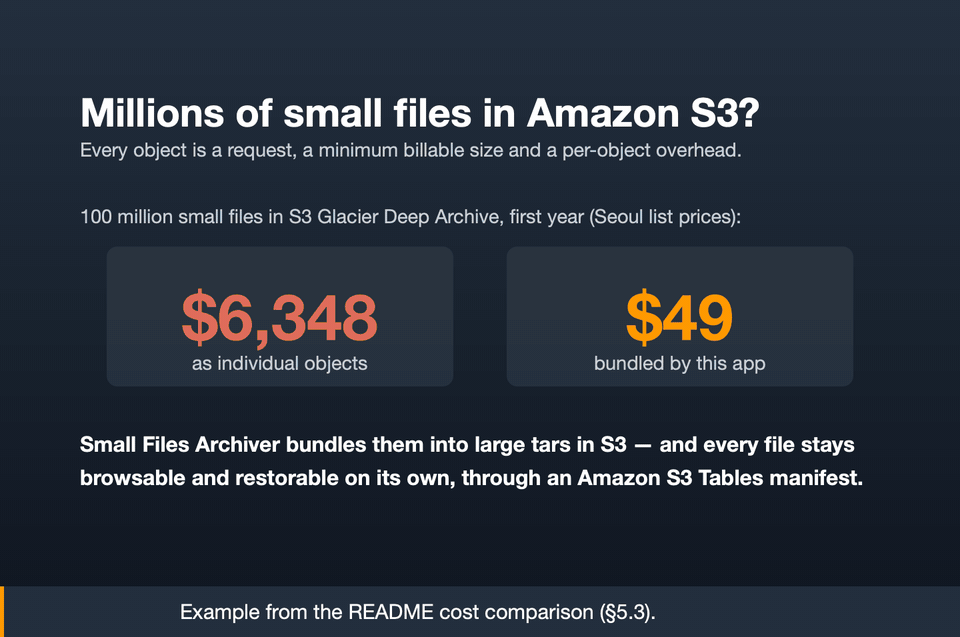
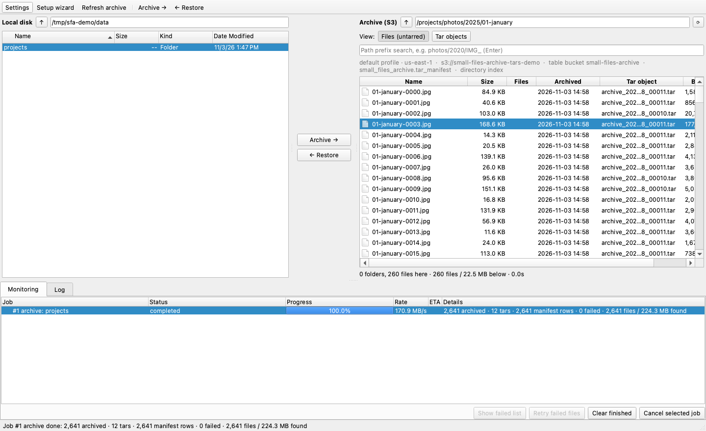
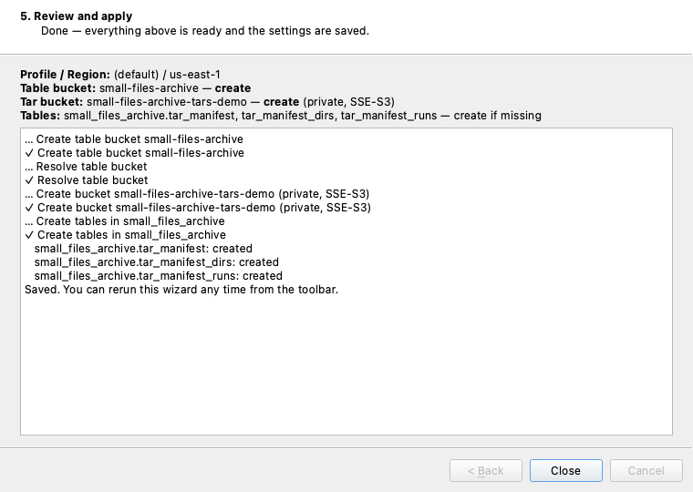
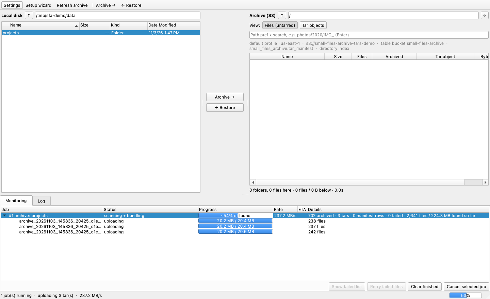

# Small Files Archiver → S3 + S3 Tables Manifest

> 🌐 **English**: [README.md](README.md) · 한국어 문서입니다.

파일시스템의 대량 소용량 파일을 **tar로 번들링**하여 Amazon S3에 저장하고, 각 파일의 위치 정보(어느 tar의 어느 byte 범위에 있는지)를 **Amazon S3 Tables(관리형 Apache Iceberg)** 테이블에 기록하는 아카이빙 솔루션입니다.

원본은 [aws-samples/small-files-archiving-solution](https://github.com/aws-samples/small-files-archiving-solution)이며, 이 버전은 매니페스트 저장을 CSV 오브젝트에서 S3 Tables로 전환하고, 단일 읽기 MD5·스트리밍 tar·배치 커밋·멀티프로세스 병렬화를 적용해 재구성했습니다.

<p align="center">
  <a href="gui/docs/demo.mp4"></a><br>
  <b>▶ 미리보기를 클릭하면 1분 소개 영상(MP4, AWS에서 녹화)을 볼 수 있습니다</b>
</p>

## 데스크톱 GUI — 여기서 시작하세요

가장 쉬운 사용 방법은 [`gui`](gui/README.md)의 데스크톱 앱입니다. 모든 화면의 단계별 설명은 **[GUI 사용자 가이드](gui/README.md)**(영문)를 참고하세요.



▶ **[1분 소개 영상](gui/docs/demo.mp4)**: 소용량 파일이 왜 비싼지, 그리고 설정, 두 가지 소스(로컬 디스크 또는 S3 버킷), EC2에서 S3 버킷의 객체 482,980개 아카이빙, 파일 보기와 tar 보기 전환, 복원. **[2분 둘러보기](gui/docs/demo-walkthrough.mp4)**: 로컬 디스크의 파일 523,124개 아카이빙, 탐색, 복원, incremental 실행.

```bash
cd gui && ./run-gui.sh      # 첫 실행 시 자체 Python 환경을 만듭니다
```

1. **설정:** 첫 실행 마법사가 S3 Tables table bucket, 매니페스트 테이블, 비공개 tar 버킷을 이름으로 선택하거나 생성합니다. ARN을 찾을 필요가 없습니다. → [가이드 §2](gui/README.md#2-first-run-setup-wizard)
2. **아카이빙:** 왼쪽에서 폴더를 선택하고 **Archive →**를 누릅니다. 처리 중인 tar마다 번들링/업로드 진행 막대가 표시됩니다. → [§4](gui/README.md#4-archive-files)
3. **탐색:** 오른쪽 패널에 **원본 파일과 폴더**가 보이고, 각 파일이 담긴 tar와 byte 범위도 표시됩니다. **Tar objects**로 전환하면 tar 자체를 볼 수 있습니다. → [§5](gui/README.md#5-browse-the-archive)
4. **복원:** 오른쪽에서 파일이나 폴더를 선택하고 **← Restore**를 누릅니다. 필요한 byte 범위만 가져오고 MD5를 검증합니다. → [§6](gui/README.md#6-restore-files)

GUI에서는 [incremental 실행](gui/README.md#7-incremental-archiving), [파일 목록 리포트 입력](gui/README.md#8-archive-from-a-file-list-report), [실패 파일 원클릭 재시도](gui/README.md#9-failed-files-and-retry)도 지원합니다.

| 설정 마법사 | 아카이빙 진행 중 |
|---|---|
|  |  |

이 문서의 나머지 부분은 GUI가 내부에서 실행하는 명령줄 아카이버와 복원 스크립트를 설명합니다.

### 주요 기능

- **데스크톱 GUI** — 설정 마법사, 이중 패널 탐색(원본 파일 ↔ tar 객체), tar별 진행 상황을 보여주는 아카이빙/복원, incremental 실행, 리포트 입력, 실패 파일 재시도. 위 내용 참고.
- **S3 버킷 소스** — 버킷/prefix, S3 Inventory 또는 s3tar 매니페스트의 객체를 256개 동시 GET으로 아카이빙하며, 각 객체를 S3가 저장한 체크섬과 대조합니다. §3 참고.
- **파일 번들링** — 다수의 소용량 파일을 큰 tar 오브젝트로 묶어 PUT 요청 수를 줄이고 소용량 과금 페널티(예: Glacier IR 128KB 최소 과금)를 회피.
- **S3 Tables 매니페스트** — 각 파일의 `tar_key` + byte 범위를 관리형 Apache Iceberg 테이블에 기록해, tar 안의 개별 파일을 계속 찾을 수 있게 함.
- **개별 파일 직접 복원** — tar 전체를 내려받지 않고 byte-range GET으로 tar에서 파일 하나만 바로 추출(`fss3-restore.py`).
- **두 가지 입력 모드** — 디렉터리 순회(`--src-path`), 또는 지정한 파일 목록을 아카이빙하는 `--input-file`(DB export·`find`·변경 목록 등).
- **파일별 MD5 무결성** — 모든 파일을 해싱(단일 읽기, `--md5`)해 매니페스트에 저장하므로 복원 시 바이트 단위로 검증 가능. 아카이브에 무결성 검증은 필수이므로 항상 켜세요.
- **멀티프로세스 병렬화** — tar 패킹·업로드를 워커 프로세스로 병렬화해 GIL 우회; 매니페스트 커밋은 배치로 묶어 Iceberg 작은 파일·스냅샷 폭증 방지.
- **파일 스캔 병렬화(선택)** — 소스 트리 순회를 `--scan-threads` 개 스레드가 나눠 처리하고 크기 제한 큐로 넘길 수 있으므로, 지연(latency)에 묶인 네트워크 파일시스템에서 파이프라인 전체가 스레드 1개의 stat 처리량에 갇히지 않습니다. 기본값은 직렬 순회이고, 소스가 원격일 때 선택적으로 올립니다.
- **동시 실행 안전** — 여러 아카이버 실행이 하나의 매니페스트 테이블에 동시에 쓸 수 있고, 각 실행은 자체 tar 이름 공간을 가집니다. [§6](#6-여러-아카이버-동시-실행) 참조.

> ⚠️ 공식 AWS 문서가 아닙니다. 현장 테스트 기반 자료입니다.

---

## 1. 솔루션 소개

### 왜 번들링인가

수십 KB 단위 파일이 수십만~수십억 개인 아카이브를 S3에 개별 오브젝트로 올리면 두 가지 비용이 폭증합니다.

- **요청 비용**: 파일 1개당 PUT 1건 → 수백만~수십억 PUT
- **소용량 페널티**: Glacier Instant Retrieval·Standard-IA는 **128KB 최소 과금**, Glacier Flexible/Deep Archive는 **객체당 40KB 메타데이터 오버헤드**. 수십 KB 파일에는 실제 크기보다 훨씬 큰 요금이 부과됩니다.

파일들을 큰 tar(예: 20MB)로 묶으면 오브젝트 수가 수백~수천 배 줄어 위 두 비용이 사실상 사라집니다. 대신 "tar 안의 개별 파일을 어떻게 찾고 꺼내느냐"가 문제인데, 이를 **매니페스트(파일→tar+byte범위 인덱스)** 로 해결합니다.

### 아키텍처

```
파일 소스 (--src-path 디렉터리 순회, 또는 --input-file 목록 파일)
   └─ K개 스캐너 스레드(--scan-threads)가 병렬로 순회
        │  각 스레드가 --max-size / --max-files 기준으로 배치를 닫아 push
        └─ 크기 제한 배치 큐
             └─ 메인 스레드가 tar 이름을 부여하고 submit
                  └─ ProcessPoolExecutor (N개 워커 프로세스)
                        │  각 워커: tar 생성 (옵션 MD5) + S3 multipart 업로드
                        │  → 매니페스트 행 반환
                        └─ 단일 writer 스레드 → S3 Tables 배치 커밋 (기본 50,000행)
```

스크립트: `fss3-archiver-s3tables-mp.py` (멀티프로세스). tar 패킹·MD5 등 CPU 작업은 워커 프로세스로 병렬화하여 GIL을 우회하고, 파일 스캔은 CPU가 아니라 지연에 묶이는 작업이므로 스레드로 병렬화합니다.

설계 포인트:

| 항목 | 방식 | 이유 |
|---|---|---|
| MD5 | tar 스트리밍 중 1회 계산 (옵션) | 파일을 2번 읽지 않음 |
| tar 버퍼 | `SpooledTemporaryFile` (임계 초과 시 디스크 spill) | 대용량 tar의 RAM 상주 방지 |
| byte offset | tar 스트림 `tell()` 위치 | tar 헤더·패딩 포함 실제 물리 위치 → byte-range 복원 정확 |
| 파일 스캔 | K개 스레드가 공유 큐에서 디렉터리를 꺼내 처리 | 항목당 `lstat` 왕복 1회는 지연에 묶인 작업이고, `getdents`/`lstat`는 GIL을 해제하므로 스레드가 실제로 대기 시간을 겹침 |
| 스캔 ↔ 패킹 연결 | 크기 제한 큐 + 메인 스레드는 **먼저 끝난** tar부터 수거 | tar 업로드를 기다리는 동안에도 순회가 계속 진행됨(교대로 멈추지 않음), 느린 업로드 1건이 윈도우를 막지 않음 |
| 매니페스트 쓰기 | 실행 1건당 **단일** writer가 배치 커밋 | 한 실행의 커밋을 직렬화해 스냅샷 증가를 최소화 (여러 실행 동시 쓰기도 안전 — [§6](#6-여러-아카이버-동시-실행) 참조) |
| 커밋 재시도 | full-jitter 지수 백오프(`--commit-retries`) | 고정 백오프는 충돌한 두 writer가 같은 간격으로 다시 충돌하게 만듦 |
| 프로세스 시작 | `spawn` 컨텍스트 | writer 스레드가 락을 쥔 상태에서 fork 시 자식 데드락 방지 |
| S3 Tables 연결 | S3 Tables Iceberg REST endpoint 직접 사용 | Lake Formation 설정 불필요 |

---

## 2. 설치 방법

- **Python 3.9+** (테스트 환경: 3.12.1)
- 사전 생성된 S3 버킷(tar 저장용)과 S3 Tables 테이블 버킷(매니페스트용). 네임스페이스·테이블은 스크립트가 자동(idempotent) 생성.

```bash
pip install -r archiver/requirements.txt   # boto3[crt]: fast CRC64NVME
# 테스트 검증: pyiceberg 0.11.1 / pyarrow 18.1.0 / boto3 1.39.17
# pyiceberg 0.12 이상은 day 파티션 테이블에 append하려면 pyiceberg-core extra가 필요 (0.12.0 / pyarrow 26.0.0 / boto3 1.43에서도 검증)
```

필요 IAM 권한 (매니페스트, S3 Tables 직접 endpoint 기준):

```
s3tables:GetTableBucket, ListNamespaces, CreateNamespace, GetNamespace,
s3tables:ListTables, CreateTable, GetTable,
s3tables:GetTableMetadataLocation, UpdateTableMetadataLocation,
s3tables:PutTableData, GetTableData
+ tar 저장 버킷에 대한 s3:PutObject
```

> 최소 권한 IAM 정책 예시(아카이버, 탐색/복원, 설정 마법사): [GUI 가이드의 IAM permissions](gui/README.md#iam-permissions) 참고.


---

## 3. 실행 방법

모든 실행은 **파일 소스**(`--src-path` 순회 또는 `--input-file` 목록)와 **배치 기준**(`--max-size` 또는 `--max-files`)의 조합입니다. 아래 시나리오는 대상/S3 Tables 관련 플래그를 공유하며, 소스와 배치 선택만 달라집니다.

> 💡 [`archiver/run.sh`](archiver/run.sh)에 아래 모든 시나리오(+복원)를 바로 실행 가능한 bash 함수로 담아 뒀습니다 — 상단 공용 변수를 수정하고, 함수 호출 한 줄의 주석을 해제한 뒤 `bash run.sh`로 실행하세요.

**기본 — 디렉터리를 균일 크기 tar로 번들링 (가장 일반적):**

```bash
python archiver/fss3-archiver-s3tables-mp.py \
  --src-path         /data/nfsshare \
  --dst-bucket       your-own-dest-bucket \
  --dst-prefix       20260804 \
  --max-size         20MB \
  --num-workers      8 \
  --md5 \
  --region           ap-northeast-2 \
  --table-bucket-arn arn:aws:s3tables:ap-northeast-2:<account>:bucket/<table-bucket> \
  --namespace        small_files_archive \
  --table-name       tar_manifest \
  --batch-size       50000 \
  --tar-storageclass GLACIER_IR
```

나머지 시나리오는 위 기본 명령에서 **아래 플래그만 바꾼 것**입니다:

**tar당 파일 개수 고정** — 크기 대신 tar당 N개로 제한:

```bash
  --max-files 1000          # --max-size 대체
```

**지정한 파일 목록 아카이빙** — 트리를 순회하지 않고, DB export·`find` 결과·변경 목록에서 온 파일 집합을 처리:

```bash
  --input-file files-to-archive.txt --max-files 1000
```

한 줄에 절대 경로 하나(빈 줄·`#` 주석은 건너뜀). 존재하지 않거나 읽을 수 없는 경로는 실패로 집계되어 실패 파일 목록에 기록되고, 심볼릭 링크와 일반 파일이 아닌 항목은 건너뜁니다. 어느 쪽도 실행을 멈추지 않습니다. CSV/TSV 리포트도 입력으로 쓸 수 있습니다(`--input-format` / `--path-column` 참고). `--src-path`는 여전히 필수 — 각 tar 멤버의 상대 경로 기준이며, 경로는 `--src-path` 안으로 해석되어야 합니다(심볼릭 링크 상위 폴더와 `..`를 먼저 해석). 밖에 있는 경로는 거부되어 실패로 기록되며, `--allow-outside-src`를 주면 앞의 `/`를 뗀 전체 경로로 저장됩니다. `find -print0`로 만든 목록은 어떤 파일 이름에도 안전한 `--input-format nul`을 사용하세요.

**콜드·write-once 데이터 — 압축:**

```bash
  --compress --tar-storageclass DEEP_ARCHIVE
```

⚠️ `--compress`는 byte-range 개별 복원을 비활성화하며(offset이 `-1`로 기록됨), `DEEP_ARCHIVE`는 읽기 전에 tar 전체 restore가 필요합니다 — 파일 단위로 다시 읽지 않을 아카이브에만 함께 쓰세요. [제약 사항](#제약-및-주의사항) 참고.

파일 하나를 다시 꺼내는 방법은 [§4.2](#42-복구--byte-range-get으로-개별-파일-추출)에서 다룹니다(경로로 LOOKUP, 또는 알려진 offset으로 DIRECT).

### S3 버킷을 소스로 아카이빙 (`s3s3-archiver-s3tables-mp.py`)

같은 파이프라인, 매니페스트, 탐색기, 복원, incremental, Resume, 실패 파일 목록이 **S3 버킷을 소스로** 할 때도 그대로 동작합니다. 객체 단위로 저장하거나 차가운 클래스로 옮기기에는 비용이 큰, 소용량 객체가 가득한 버킷에 사용하세요.

> ⚠️ **노트북이 아니라 소스 버킷과 같은 리전에서 실행하세요.** 아카이버가 S3에서 AWS 밖의 컴퓨터로 읽어 오는 모든 바이트는 **S3 데이터 전송(DTO)** 요금이 붙습니다. 서울 기준 월 첫 10 TB까지 약 $0.126/GB로, **TB당 약 $129**, **10 PB면 약 130만 달러**입니다. 같은 리전의 EC2(또는 CloudShell)에서는 GET 요청 요금 외에 읽기 비용이 없고, 속도도 몇 배 빠릅니다. 퍼블릭 서브넷이나 S3 Gateway VPC 엔드포인트를 사용하세요. NAT Gateway는 약 $0.059/GB가 과금됩니다. GUI는 **Run on**이 *This computer*일 때 이 경고를 다시 보여 줍니다. [EC2에서 실행하는 두 가지 방법](#ec2에서-실행하는-두-가지-방법) 참고.

```bash
python archiver/s3s3-archiver-s3tables-mp.py \
  --src-s3           s3://source-bucket/data/fs1/ \
  --src-prefix       data/ \
  --dst-bucket       your-own-dest-bucket \
  --dst-prefix       s3-archive \
  --max-size         256MB \
  --num-workers      8 \
  --get-concurrency  256 \
  --region           ap-northeast-2 \
  --table-bucket-arn arn:aws:s3tables:ap-northeast-2:<account>:bucket/<table-bucket>
```

| 옵션 | 의미 | 기본값 |
|---|---|---|
| `--src-s3 s3://bucket/prefix` | prefix 아래의 모든 객체를 아카이빙: `/` 기준으로 나눠 병렬 `ListObjectsV2` 순회 | — |
| `--src-manifest FILE` | **s3tar CSV**(`bucket,key,size[,etag]`), **S3 Inventory** `manifest.json`(CSV 또는 Parquet), 또는 한 줄에 `s3://bucket/key` 하나(실패 파일 목록)에 나열된 객체를 아카이빙. 로컬 경로 또는 `s3://` | — |
| `--src-prefix` | 키를 이 prefix 기준 상대 경로로 저장: 목록 prefix(기본값), 상위 prefix(`data/`면 `fs1/…` 유지), 또는 `""`(전체 키) | 목록 prefix |
| `--get-concurrency` | 소스 GET 동시 요청 수(전체), `--num-workers` 프로세스에 나눠 배분 | 256 |
| `--get-client` | 32 MiB 미만 객체의 소스 GET 클라이언트: `crt`(AWS CRT S3 클라이언트, 네이티브 코드) 또는 `boto3`. 더 큰 객체는 항상 boto3로 스트리밍 | `crt` |
| `--list-threads` | 병렬 목록 조회 / HeadObject 스레드 수 | 16 |
| `--verify-source-checksum` | 각 객체의 바이트를 S3가 저장한 전체 객체 체크섬(CRC64NVME, CRC32C, CRC32, SHA256, SHA1)과 비교. 다르면 해당 객체는 실패 처리 | on |
| `--src-region` | 소스 버킷의 리전 | `--region` |

대상, 번들링, 업로드, 매니페스트, `--incremental`(LastModified 기준), `--resume-run`, `--part-size` 옵션은 로컬 아카이버와 같습니다.

**시간이 어디에 쓰이는가.** 소용량 객체는 작업을 **GET 바운드**로 만듭니다. 리전 안에서 객체당 요청 1건, 건당 약 10~20 ms입니다. 그래서 각 워커는 배치를 많은 동시 GET으로 가져와 순서대로 tar에 씁니다. S3는 prefix 파티션당 초당 약 5,500건의 GET을 처리하며, `503 SlowDown` 응답은 백오프와 지터를 적용한 재시도로 흡수합니다.

boto3로 프로파일링해 보니 병목은 **네트워크가 아니라 CPU**였습니다. CPU의 약 60%가 botocore의 요청당 처리(적응형 재시도 속도 제한기, `Last-Modified` 파싱, Python의 HTTP·TLS)에 쓰였고, 체크섬 검증은 약 5%였습니다. 기본값 `--get-client crt`는 소용량 객체 GET을 AWS CRT S3 클라이언트로 보냅니다. 서명, 송수신을 네이티브 코드에서 처리합니다. 여전히 객체당 일반 GET 1건이므로 S3가 같은 전체 객체 체크섬 헤더를 돌려주고, CRC64NVME 비교 방식도 그대로입니다.

`ap-northeast-2`의 EC2(Amazon Linux 2023, SSM으로 실행)에서 실측: 객체 523,124개(9.95 GiB), 객체당 정확히 GET 1건, 모든 체크섬 검증, 실패 0건.

| 인스턴스 | 클라이언트 | 워커 / GET | 처리량 |
|---|---|---|---|
| m5.2xlarge (vCPU 8) | boto3 (이전) | 8 / 256 | 35.5 MB/s |
| m5.2xlarge | crt | 8 / 256 | 77.8 MB/s |
| m5.2xlarge | crt | 16 / 512 | 92.0 MB/s |
| c6in.8xlarge (vCPU 32) | crt | 32 / 1024 | 167.5 MB/s |
| c6in.8xlarge | crt | 48 / 1536 | **180.8 MB/s** |

처리량은 vCPU 수에 따라 늘어납니다. 워커는 vCPU + 16개(vCPU당 최대 2개), 워커당 GET 32개로 시작하면 좋습니다. GUI에서 인스턴스를 고르면 이 값이 자동으로 채워집니다. c6in에서 fs1 실행은 약 1분이라, 시작과 목록 조회 램프업 시간이 이 평균에 포함되어 있습니다.

**체크섬.** CRC64NVME는 각 객체가 tar로 스트리밍되는 동안 계산되어 S3 고유 인코딩으로 저장됩니다. 그래서 소스 객체의 `x-amz-checksum-crc64nvme`나 **S3 Batch Operations "compute checksum"** 리포트와 바로 비교할 수 있습니다. S3는 새로 업로드되는 객체에 기본으로 전체 객체 CRC64NVME를 붙입니다. 테스트에서는 523,124개 객체 모두 이 체크섬을 갖고 있었고, 2,000개 샘플이 정확히 일치했습니다. *복합(composite, 멀티파트)* 체크섬만 가진 객체는 바이트 단위 비교가 불가능하므로 비교 없이 아카이빙됩니다.

#### EC2에서 실행하는 두 가지 방법

두 방법 모두 GUI의 **Archive from S3** 대화상자에서 시작하며, GUI가 쓰는 것과 정확히 같은 버전의 아카이버를 실행합니다. 아카이버는 `s3://<tar 버킷>/_sfa/runner/<버전>/`에 올라가고, 인스턴스는 이를 전용 Python 3.12 환경에 한 번만 설치합니다(미리 빌드된 wheel만 사용).

| | **A. SSM으로 EC2에서 실행** (권장) | **B. 스크립트를 복사해 직접 실행** |
|---|---|---|
| 방법 | **Run on**에서 인스턴스를 고르고 **Start archiving** | **Copy script for EC2**를 누르고, 인스턴스의 터미널(SSH, Session Manager, EC2 Instance Connect)에 붙여 넣기 |
| 필요 조건 | 인스턴스가 Systems Manager에서 Online이고, GUI 사용자가 그 인스턴스에 `ssm:SendCommand` 가능 | 인스턴스의 셸만 있으면 됨 |
| 진행 상황 | GUI에서 진행 막대, 속도, ETA, 로그를 실시간으로 확인. GUI를 닫았다 다시 열면 다시 연결됨 | 스크립트가 출력한 로그 파일을 `tail -f` |
| 취소 / 재개 | GUI의 버튼 | `kill -INT <pid>`(정상 취소). 재개는 `RESUME_OF=<run id>`를 넣어 스크립트를 다시 붙여 넣기 |
| 적합한 경우 | 일상적인 실행 | SSM을 쓸 수 없을 때, 예약 실행, CloudShell, 여러 인스턴스가 소스를 나눠 아카이빙할 때 |

- **인스턴스 역할:** 아카이버 권한([GUI 가이드의 IAM](gui/README.md#iam-permissions) 참고)과 tar 버킷의 `_sfa/runner/*`에 대한 `s3:GetObject`. A는 추가로 `_sfa/jobs/*`에 대한 `s3:PutObject`(진행 상황)와 `AmazonSSMManagedInstanceCore`.
- **크기:** 워커는 vCPU + 16개(vCPU당 최대 2개), 워커당 GET 32개. 인스턴스를 고르면 대화상자가 이 값을 채워 줍니다(위 표 참고).
- **네트워크:** 퍼블릭 서브넷이나 S3 Gateway VPC 엔드포인트를 사용하고, NAT Gateway는 피하세요.
- **GUI 없이:** 인스턴스에서 `pip install -r archiver/requirements.txt` 후 이 절 맨 위의 명령을 실행하세요.

두 방법의 단계별 안내: [GUI 가이드의 Run on EC2](gui/README.md#run-on-ec2-no-data-transfer-out).

GLACIER 또는 DEEP_ARCHIVE 객체는 "restore it in S3 first"로 실패 처리됩니다. 폴더 마커는 건너뜁니다. `../x`처럼 상대 경로로 쓸 수 없는 키는 거부됩니다. 소스는 절대 수정하거나 삭제하지 않습니다.

소스용 추가 IAM: 소스 버킷에 대한 `s3:ListBucket`(`s3:prefix` 조건 포함), `arn:aws:s3:::<source-bucket>/<prefix>*`에 대한 `s3:GetObject`, 그리고 `--src-manifest`로 S3 Inventory를 쓰는 경우 인벤토리 버킷에 대한 `s3:GetObject`.

### 주요 파라미터

| 파라미터 | 설명 | 기본값 |
|---|---|---|
| `--src-path` | 아카이빙할 소스 디렉터리 (하위 재귀); `--input-file` 사용 시엔 각 파일의 상대 경로 계산 기준 | (필수) |
| `--input-file` | `--src-path` 순회 대신 아카이빙할 파일을 나열한 텍스트 파일 (한 줄에 경로 하나; `#` 주석·빈 줄 무시) | off (순회) |
| `--dst-bucket` / `--dst-prefix` | tar 저장 S3 버킷 / prefix | (필수) |
| `--max-size` **또는** `--max-files` | tar 1개당 크기(예 `512MB`) 또는 파일 개수 (택1) | (필수) |
| `--num-workers` | tar 생성·전송 워커 프로세스 수 | `os.cpu_count()` |
| `--scan-threads` | 소스 트리를 순회하는 스레드 수 (아래 참고) | 1 |
| `--run-id` | tar 이름·로그 파일명에 들어가 동시 실행을 구분하는 토큰 | `<타임스탬프>_<pid>_<랜덤>` |
| `--md5` | 무결성 검증용 파일별 MD5 계산·저장 | on (기본값) |
| `--region` | AWS 리전 | (필수) |
| `--table-bucket-arn` | S3 Tables 테이블 버킷 ARN | (필수) |
| `--namespace` / `--table-name` | 매니페스트 네임스페이스 / 테이블 | small_files_archive / tar_manifest |
| `--batch-size` | 매니페스트 커밋당 행 수 | 50000 |
| `--flush-interval` | 배치가 다 차지 않아도 커밋하는 대기 시간(초) | 15 |
| `--commit-retries` | 매니페스트 커밋 1건당 시도 횟수 (초과 시 실행 중단) | 8 |
| `--dir-index` / `--no-dir-index` | GUI가 수십억 파일 규모에서도 폴더 단위로 목록을 조회할 수 있도록 `<table-name>_dirs` 디렉터리 인덱스와 매니페스트 `parent_dir` 컬럼을 유지 (기존 테이블엔 additive 스키마 진화로 `parent_dir` 추가) | on |
| `--walk-path` | `--src-path` 하위의 이 디렉터리/파일만 순회 (반복 지정 가능); 경로는 `--src-path` 기준 상대 경로이므로 `--src-path /data --walk-path /data/photos`는 `photos/...`로 저장 | off |
| `--progress` | JSON 진행 상황 스냅샷을 stdout에 출력 (`@@PROGRESS ` 접두사); GUI가 사용 | off |
| `--incremental` | **같은 소스**(동일한 `--src-path` + `--walk-path` 조합)의 마지막 성공(`ok`/`partial`) 실행 시작 시각 이후 mtime **또는** ctime이 바뀐 파일만 아카이빙 (`<table-name>_runs`에서 조회). ctime으로 이름 변경/이동도 감지. 소스의 첫 실행은 전체를 아카이빙. `--input-file`과 함께 쓸 수 없음 | off |
| `--watermark-skew` | 호스트/파일 서버 간 시계 차이를 흡수하기 위해 워터마크에서 빼는 초; 겹치는 구간의 파일은 다시 아카이빙될 뿐 누락되지 않음 | 300 |
| `--input-format` | `--input-file` 형식: `lines`(한 줄에 경로 하나), `nul`(NUL 구분, `find -print0`), `csv`, `tsv`(파일 목록 리포트); `auto`는 확장자로 판단; `.gz`는 자동으로 해제 | auto |
| `--resume-run` | 중단된(취소·실패) 실행을 이어서 진행: 같은 소스를 다시 아카이빙하되 그 실행이 이미 아카이빙한 파일은 건너뛰므로 누락도 중복도 없음. 여러 번 이어 받은 경우 반복 지정. 그 실행의 파일 이름 집합을 메모리에 둠(파일당 약 100 B). GUI: **Resume** | — |
| `--allow-outside-src` | `--src-path` 밖으로 해석되는 `--input-file` 경로도 허용 (기본은 거부 — 목록으로 호스트의 다른 파일을 끌어오지 못하게 함) | off |
| `--path-column` | csv/tsv 리포트에서 경로가 들어 있는 컬럼: 헤더 이름(예: `path`) 또는 0부터 시작하는 인덱스. 상대 경로는 `--src-path` 기준 | 0 |
| `--run-history` / `--no-run-history` | 모든 실행(상태, 건수, 워터마크, 실패 목록 위치)을 `<table-name>_runs`에 기록; `--incremental`에 필요 | on |
| `--tar-storageclass` | tar 오브젝트 스토리지 클래스 (아래 참고) | STANDARD |
| `--part-size` | 멀티파트 업로드 part 크기(단일 PUT 임계값 겸용): `8MB`, `16MB`, `32MB`, `64MB`. part마다 요청이 과금됨 — §5.3 참고 | 32MB |
| `--upload-client` | tar 업로드 클라이언트: `crt`(AWS CRT S3 클라이언트, 네이티브 TLS·멀티파트) 또는 `boto3`. 둘 다 CRC64NVME 체크섬을 보내고 S3가 요청마다 검사 | `crt` |
| `--verify-tar-upload` / `--no-verify-tar-upload` | 업로드 후 S3가 저장한 tar 전체 객체 CRC64NVME를 패킹한 바이트의 CRC64NVME와 비교(tar당 HeadObject 1건, tar에 대한 `s3:GetObject` 필요). 다르면 해당 tar는 실패 처리되고 행이 기록되지 않음 | on |
| `--tar-layout` | `--dst-prefix` 아래 tar 폴더 구조: `run` = `<prefix>/<run-id>/`(실행마다 폴더 하나 — full/incremental 실행을 단위로 확인·정합성 점검·정리), `date` = `<prefix>/<YYYYMMDD>/`(이전 방식), `flat` = `<prefix>/`. 매니페스트에 tar 전체 키가 저장되므로 기존 아카이브는 그대로 동작 | run |
| `--spool-max-mb` | tar를 메모리에 두는 임계(초과 시 디스크) | 256 |
| `--compress` | tar를 gzip 압축 (⚠️ 아래 제약 참고) | off |

**실패 파일과 재시도.** 아카이빙하지 못한 모든 파일은 `logs/<dst-prefix>/failed_<run-id>.txt`에 한 줄에 절대 경로 하나씩 스트리밍으로 기록됩니다. stat 오류, 읽을 수 없는 파일, 업로드에 실패한 tar에 들어 있던 모든 파일이 대상입니다. 옆의 `.tsv`에는 실패 사유가 남습니다. 같은 설정으로 재시도하세요:

```bash
python archiver/fss3-archiver-s3tables-mp.py --src-path <동일한 기준 경로> \
  --input-file logs/<dst-prefix>/failed_<run-id>.txt ...   # 동일한 병렬 파이프라인
```

심볼릭 링크와 특수 파일은 실패가 아니라 **skipped**로 집계되며 목록에 넣지 않습니다. 재시도해도 다시 건너뛰기 때문입니다. 실행 결과는 `ok`(실패 없음), `partial`(일부 실패 — 워터마크는 전진하므로 목록으로 재시도) 또는 `failed`입니다.

저장 경로: tar는 기본적으로 `s3://<bucket>/<prefix>/<run-id>/archive_<run-id>_<NNNNN>.tar`(`--tar-layout run`; `date`는 이전처럼 `<YYYYMMDD>/` 아래, `flat`은 prefix 바로 아래), 매니페스트는 S3 Tables 테이블에 기록.

> ⚠️ incremental 실행을 쓰면 이전 실행 폴더에는 그 이후 바뀌지 않은 모든 파일이 남아 있습니다 — 실행 폴더는 실패하거나 취소된 실행의 것만 삭제하고, 성공한 실행의 폴더는 "정리" 목적으로 지우지 마세요.

#### `--scan-threads`

소용량 파일 순회는 항목마다 `lstat` 왕복이 필요하므로 네트워크 파일시스템에서는 **CPU가 아니라 지연에 묶입니다** — 워커 프로세스를 몇 개 띄우든 스레드 1개로는 대략 초당 500~2,000개 수준에서 한계에 도달합니다. `getdents`/`lstat`가 GIL을 해제하기 때문에 스레드가 효과를 냅니다.

**기본값은 1(직렬 순회)입니다.** 스레드는 지연을 겹치기 위해 존재하므로, 겹칠 지연이 있을 때만 효과가 있고 그 여부는 소스에 따라 완전히 달라집니다. 항목당 1ms stat(콜드 캐시 NFS와 유사한 조건)을 모사하면 거의 선형으로 확장됩니다:

| `--scan-threads` | 1 | 4 | 8 | 16 | 32 |
|---|---|---|---|---|---|
| 속도 향상 (1ms/항목 모사) | 1.0x | 4.1x | 8.0x | 16.2x | 30.0x |

반면 **로컬 NVMe** 트리(523,124개 파일, 매 측정 전 페이지 캐시 drop)에서는 같은 코드가 전혀 다르게 동작합니다 — 직렬 30,120 files/s, 4스레드에서 1.9x로 정점, 8스레드 이상은 평탄:

| `--scan-threads` | 1 | 2 | 4 | 8 | 16 | 32 |
|---|---|---|---|---|---|---|
| 속도 향상 (로컬 NVMe, 콜드) | 1.0x | 1.6x | **1.91x** | 1.54x | 1.54x | 1.54x |

그리고 콜드 상태 100만 파일 end-to-end 실행 4회에서 스캔 스레드 1개와 8개의 총 소요 시간은 **차이가 없었습니다**(모두 57.3~58.5 MB/s) — 벽은 순회가 아니라 볼륨의 IOPS 예산이었습니다. 기본값을 1로 둔 이유가 이것입니다: 직렬 순회가 예측 가능한 기준선이고, 값을 올리는 것은 진짜로 지연에 묶인 소스(네트워크 NFS/SMB, 크로스 AZ, 크로스 리전)를 위한 선택입니다. 올리기 전에 마운트의 실제 상한을 먼저 측정하세요 — 스레드 수보다 서버나 NFS RPC slot 제한이 먼저 한계일 수 있습니다:

```bash
# 직렬 순회 비용
sudo sh -c 'echo 3 > /proc/sys/vm/drop_caches'
time find /data/nfsshare -type f -printf ''

# 같은 작업을 상위 서브디렉터리 단위로 병렬 분산
sudo sh -c 'echo 3 > /proc/sys/vm/drop_caches'
time ls -d /data/nfsshare/*/ | xargs -P 8 -I{} find {} -type f -printf ''
```

두 시간이 같다면 파일시스템이 벽이므로 스캔 스레드를 늘려도 소용이 없습니다.

#### `--tar-storageclass` 값

이 값은 S3 `PutObject`에 그대로 전달되므로 모든 S3 스토리지 클래스를 지정할 수 있습니다. 이 솔루션에서 핵심 기준은 **개별 파일 복원(§4.2)이 즉시 되는지, 아니면 tar 전체 restore가 선행되어야 하는지**입니다:

| 클래스 | 개별 복원(§4.2) | 비고 |
|---|---|---|
| `STANDARD` | ✅ 즉시 | **기본값.** 최소 저장 기간도 조회 요금도 없어 첫 실행·테스트에서 예상 밖 비용이 발생하지 않습니다. 대신 GB당 저장 비용은 가장 높습니다. |
| `GLACIER_IR` | ✅ 즉시 | Glacier Instant Retrieval — 아카이브 요금에 밀리초 range GET. **실제 콜드 아카이브에는 이 값이 정답**이며, 대가는 90일 최소 저장 기간과 GB당 조회 요금입니다. |
| `STANDARD_IA` / `ONEZONE_IA` | ✅ 즉시 | 저빈도 접근, GB당 조회 요금. `ONEZONE_IA`는 단일 AZ(저렴·낮은 내구성). |
| `INTELLIGENT_TIERING` | ✅ 즉시* | 접근 패턴에 따라 자동 티어링. *객체가 선택형 Archive Access 티어로 이동하면 range GET도 restore 필요. |
| `GLACIER` (Flexible Retrieval) | ⚠️ restore 선행 | 저장 비용은 저렴하나, tar 전체 restore(수 분~수 시간) 전에는 §4.2 실패. |
| `DEEP_ARCHIVE` | ⚠️ restore 선행 | 저장 비용 최저. tar 전체 restore에 최대 ~12시간. |

> **판단 기준:** 기본값 `STANDARD`는 안전한 출발점입니다 — 최소 저장 기간도, 조회 요금도 없어 테스트 실행에서 후회할 일이 없습니다. 데이터가 실제로 콜드하다는 것이 확인되면 `GLACIER_IR`로 설정하세요 — GB당 훨씬 저렴하면서 개별 파일 즉시 복원도 그대로 됩니다. 진짜 write-once이고 tar 전체 restore 지연을 감수할 수 있을 때만 `GLACIER` / `DEEP_ARCHIVE`로 내리세요. `REDUCED_REDUNDANCY`, `EXPRESS_ONEZONE`, `OUTPOSTS`, `SNOW`, `FSX_*` 등은 API에는 있으나 이 아카이빙 워크플로에는 의미가 없습니다.

#### `--max-files` (`--max-size`) vs `--batch-size`

이름이 비슷하지만 **서로 다른 단계**를 제어하며 서로 영향을 주지 않습니다:

| 옵션 | 무엇을 자르나 | 단계 | 결과 |
|---|---|---|---|
| `--max-files` / `--max-size` | 파일 → **tar 묶음** | 업로드(입력) | S3의 **tar 오브젝트** 개수/크기 |
| `--batch-size` | 매니페스트 행 → **커밋 1회** | S3 Tables 쓰기(출력) | Iceberg **커밋(스냅샷)** 개수 |

- **`--max-files` / `--max-size`** — tar 하나에 파일 몇 개(또는 몇 바이트)를 담을지. 스캐너가 누적 개수/크기가 한도에 닿으면 새 tar로 끊습니다. 둘 중 **택1**. 이 값이 S3 tar 오브젝트 하나의 크기를 결정하며(→ PUT 요청·소용량 절감에 영향), 파일 크기가 들쭉날쭉할 때도 오브젝트가 균일하도록 보통 크기 기준(`--max-size 20MB`)을 씁니다.
- **`--batch-size`** — 단일 writer가 S3 Tables에 append하기 전에 모으는 매니페스트 행 수(**tar가 아니라 파일 1개 = 행 1개**). 기본 50,000. 값이 작으면 커밋이 잦아져 → 매니페스트에 작은 파일·스냅샷이 늘고 → 조회가 느려지므로, 대량 처리에서는 크게 유지하세요.

예시 — 100만 파일:

```
--max-files 1000    → tar 오브젝트 약 1,000개    (S3 오브젝트 수)
--batch-size 50000  → 매니페스트 커밋 약 21회     (Iceberg 스냅샷 수)
```

비유하면: `--max-files`는 파일을 몇 개의 **상자**로 포장할지, `--batch-size`는 장부에 한 번에 몇 줄의 **송장 항목**을 기록할지 정하는 것입니다. 한쪽을 바꿔도 다른 쪽은 바뀌지 않습니다.

### 매니페스트 스키마 (S3 Tables)

| 컬럼 | 타입 | 설명 |
|---|---|---|
| `tar_key` | string | 파일이 담긴 tar의 S3 키 |
| `source_key` | string | 원본 파일 상대 경로 |
| `byte_start` / `byte_end` | long | tar 내 byte 범위 (Range GET용) |
| `md5` | string | 원본 파일 MD5 (기본 계산; 비활성화한 경우에만 null) |
| `filesize` | long | 원본 파일 크기 |
| `archive_ts` | timestamptz | 아카이빙 시각 (파티션: `day(archive_ts)`) |
| `parent_dir` | string | `source_key`의 디렉터리 (루트는 `''`); `--dir-index`로 기록, 도입 이전 행은 null |

보조 테이블 `<table-name>_dirs`(`parent_dir`, `dir_path`, `files`, `bytes`, `archive_ts`, `run_id`)는 커밋마다 처리한 모든 디렉터리의 **재귀** 파일 수/바이트 합계를 담습니다. `dir_path`별로 합산하면 폴더 합계가 되며, 여러 실행에서 아카이빙된 경로는 실행마다 한 번씩 집계됩니다.

---

## 4. 조회 및 복구 방법

### 4.1 조회 — Athena 또는 PyIceberg

```sql
SELECT tar_key, byte_start, byte_end, md5
FROM small_files_archive.tar_manifest
WHERE source_key LIKE '%file0499%'
  AND archive_ts BETWEEN TIMESTAMP '2026-08-04' AND TIMESTAMP '2026-08-05';
```
> Athena 조회를 쓰려면 테이블 버킷의 AWS 분석 서비스(Glue Data Catalog) 통합이 활성화되어 있어야 합니다. PyIceberg로 직접 조회할 수도 있습니다(아래 4.2 참고).

### 4.2 복구 — byte-range GET으로 개별 파일 추출

`fss3-restore.py`를 사용합니다. 파일이 담긴 byte 범위만 가져옵니다 — 아카이버가 `byte_start`를 파일의 tar 헤더에, `byte_end`를 패딩 끝에 기록하므로, 이 범위는 그 자체로 완결된 단일 멤버 tar가 되어 `tarfile`이 바로 열 수 있습니다. tar 전체를 내려받지 않습니다.

**참고:** 매니페스트에는 `tar_key`만 있고 **버킷 이름은 저장되지 않으므로** `--tar-bucket`은 항상 필수입니다.

**DIRECT 모드** — offset을 이미 알고 있을 때(예: 4.1 조회 결과):

```bash
python archiver/fss3-restore.py \
  --tar-bucket       your-own-dest-bucket \
  --tar-key          20260804/20260804/archive_20260804_120000_31417_a3f1_00001.tar \
  --byte-start       1536 \
  --byte-end         21503 \
  --out              ./restored/file0499.dat
```

**LOOKUP 모드** — 원본 경로만 알 때. 스크립트가 매니페스트를 조회(정확한 `source_key` 일치 + Iceberg predicate pushdown — 전체 스캔 없음)하여 offset을 직접 찾습니다:

```bash
python archiver/fss3-restore.py \
  --region           ap-northeast-2 \
  --table-bucket-arn arn:aws:s3tables:ap-northeast-2:<account>:bucket/<table-bucket> \
  --namespace        small_files_archive \
  --table-name       tar_manifest \
  --source-key       sub/file0499.dat \
  --tar-bucket       your-own-dest-bucket \
  --out-dir          ./restored/ \
  --verify-md5
```

`--out`은 지정한 경로에, `--out-dir`은 그 아래에 파일의 아카이브 상대 경로를 보존해 저장합니다. `--verify-md5`(LOOKUP)는 추출한 바이트를 매니페스트 MD5와 대조하며, 두 모드 모두 `--verify-md5 <hex>`로 명시적 값을 검증할 수 있습니다. `source_key`가 여러 행에 일치하면(동일 경로를 여러 번 아카이빙한 경우) LOOKUP은 가장 최근 `archive_ts`를 선택하고 경고합니다 — 특정 행을 고르려면 4.1로 조회 후 DIRECT 모드에서 `--tar-key`를 명시하세요.

**스토리지 클래스 주의:** `STANDARD`(기본값)·`GLACIER_IR`·IA 클래스에서는 대기 없이 동작합니다. **tar가 Glacier Flexible Retrieval / Deep Archive에 있으면 먼저 tar 전체를 restore(수 시간)해야 range GET이 성공**하며, 스크립트가 이를 감지해 명확히 오류를 냅니다. `--compress`로 아카이빙한 파일은 offset이 `-1`이라 range 복원이 불가하니 `.tar.gz` 전체를 추출하세요.

---

## 5. 성능 및 비용 비교 (테스트 환경 실측)

테스트 환경: EC2(Amazon Linux, 8 vCPU, ap-northeast-2), 소스 = NFS `/data/nfsshare`(파일당 평균 ~19KB), Python 3.12.1.

### 5.1 처리 성능

100만개(fs1+fs2, 19.49GB), 8 워커, MD5 on 기준:

| 소요 | 처리율 | 실패 |
|---|---|---|
| 89.0s | 224.3 MB/s | 0 |

single-pass 해싱은 추가 읽기가 없어(tar 생성을 위해 어차피 읽는 바이트로 계산) 전송·I/O가 지배적인 이 워크로드에서 파일별 MD5 비용이 작습니다.

### 5.2 오브젝트 통합 및 요청 절감

100만개 실행 기준:

| 방식 | 오브젝트 PUT | 통합비 |
|---|---|---|
| 개별 업로드 | 1,006,108건 | — |
| **번들링 (이 솔루션)** | **1,000건** (tar 979 + 매니페스트 커밋 21) | **약 1,028 : 1** |

→ PUT 요청 **약 1,000분의 1**. tar가 20MB이므로 tar를 GLACIER_IR·IA로 옮겨도 128KB 최소 과금 페널티를 원천 회피.

### 5.3 비용 비교: 개별 객체 vs tar 번들

가격은 **아시아 태평양(서울, ap-northeast-2)** 정가로, 2026-11-03에 AWS Price List API에서 조회했습니다(세금·프리 티어 제외). 결정하기 전에 사용하는 리전의 현재 가격을 확인하세요.

**예시 데이터:** 파일 523,124개, 9.9 GiB. 평균 파일 크기는 19.9 KiB이고 모든 파일이 128 KiB 미만으로, 이 솔루션이 대상으로 하는 전형적인 소용량 파일 아카이브입니다. 번들은 256 MB tar를 32 MB part로 업로드하는 경우입니다(tar 약 42개). tar 헤더와 패딩으로 저장 바이트가 3.8 % 늘어납니다. S3 Tables 매니페스트는 파일당 약 34바이트(여기서는 17 MiB)이며 번들 스토리지 수치에 포함했습니다.

| 스토리지 클래스 | | 업로드 요청 | 업로드(1회) | 과금 스토리지 | 월 스토리지 | 첫 1년 |
|---|---|---|---|---|---|---|
| STANDARD | 개별 파일 | 523,124 | $2.35 | 9.9 GiB | $0.249 | $5.34 |
| | **tar 번들** | **415** | **$0.0019** | 10.3 GiB + 매니페스트 17 MiB | **$0.259** | **$3.10** |
| GLACIER_IR | 개별 파일 | 523,124 | $10.46 | 63.9 GiB | $0.319 | $14.29 |
| | **tar 번들** | **415** | **$0.0083** | 10.3 GiB + 매니페스트 17 MiB | **$0.052** | **$0.633** |
| DEEP_ARCHIVE | 개별 파일 | 523,124 | $31.39 | 29.9 GiB | $0.152 | $33.21 |
| | **tar 번들** | **415** | **$0.0042** | 10.3 GiB + 매니페스트 17 MiB | **$0.021** | **$0.258** |

**같은 데이터를 파일 1억 개(1.9 TiB)로 확장한 경우:**

| 스토리지 클래스 | | 업로드(1회) | 월 스토리지 | 첫 1년 |
|---|---|---|---|---|
| STANDARD | 개별 / **번들** | $450.00 / **$0.36** | $47.54 / **$49.42** | $1,020 / **$593** |
| GLACIER_IR | 개별 / **번들** | $2,000.00 / **$1.58** | $61.04 / **$9.96** | $2,732 / **$121** |
| DEEP_ARCHIVE | 개별 / **번들** | $6,000.00 / **$0.79** | $28.98 / **$4.04** | $6,348 / **$49** |

**차이가 생기는 이유:**

- **업로드 요청.** 개별 파일은 파일마다 PUT 1건이므로, tar 415건보다 요청이 1,260배 많습니다. PUT 단가도 클래스가 차가울수록 오릅니다. 서울 기준 요청 1,000건당 STANDARD $0.0045, GLACIER_IR $0.02, DEEP_ARCHIVE $0.06입니다.
- **최소 과금 크기.** GLACIER_IR(그리고 STANDARD_IA / ONEZONE_IA)는 모든 객체를 최소 128 KiB로 과금합니다. 그래서 개별 파일로 저장하면 9.9 GiB가 63.9 GiB로 과금됩니다. tar는 이 최소 크기보다 훨씬 큽니다.
- **객체당 오버헤드.** GLACIER와 DEEP_ARCHIVE는 객체마다 40 KiB를 추가합니다(아카이브 단가 32 KiB + STANDARD 단가 8 KiB). 20 KiB 파일이면 과금 크기가 세 배가 됩니다. tar 42개는 합쳐서 1.6 MiB만 늘어납니다.
- **STANDARD에서는 번들의 스토리지가 약간 더 큽니다**(tar 패딩 + 매니페스트). 하지만 요청 절감액이 첫 업로드부터 이를 넘어섭니다.
- **수명 주기 전환**은 객체당 과금됩니다. 나중에 개별 객체 523,124개를 STANDARD에서 GLACIER_IR로 옮기면 $10.46, tar 42개는 $0.001 미만입니다.
- **복원.** 파일 503개짜리 폴더를 복원할 때 개별 객체는 GET 503건, tar는 **범위 GET 1건**입니다(실측. 인접한 byte 범위를 병합). 복원 1회당 GET 절감액은 작습니다. GLACIER_IR의 GB당 조회 요금은 어느 쪽이든 같습니다.

#### 업로드 part 크기 (`--part-size`, GUI: *Upload part size*)

멀티파트 part 하나하나가 과금되는 PUT 계열 요청이므로, part가 클수록 요청이 줄어듭니다. 예시 데이터를 GLACIER_IR에 저장하는 경우:

| Part 크기 | 256 MB tar당 요청 | 요청 수(파일 52만 개) | 업로드 비용 | 파일 1억 개 업로드 비용 |
|---|---|---|---|---|
| 8 MB | 34 | 1,406 | $0.028 | $5.38 |
| 16 MB | 18 | 745 | $0.015 | $2.85 |
| **32 MB(기본값)** | **10** | **415** | **$0.0083** | **$1.59** |
| 64 MB | 6 | 250 | $0.0050 | $0.96 |

- **part 크기가 중요한 경우:** 업로드 비용이 최대 5.6배까지 차이 납니다. 번들링 자체의 절감액에 비하면 작지만 PB 규모에서는 누적됩니다.
- **큰 part의 단점:** 메모리를 더 쓰고(워커당 약 part 크기 × `--upload-concurrency`), tar 하나 안에서의 병렬도가 낮아지며, part 업로드가 실패하면 다시 보내는 데이터가 많아집니다.
- **GLACIER와 DEEP_ARCHIVE:** `UploadPart`와 `CreateMultipartUpload`는 STANDARD 요청 단가로 과금되고, `CompleteMultipartUpload`(또는 단일 `PutObject`)만 아카이브 클래스 단가로 과금됩니다.
- **작은 tar:** part 하나보다 작거나 같은 tar는 단일 PUT으로 업로드됩니다.

포함하지 않은 항목: 데이터 전송, S3 Tables 유지 관리(처리 GB당 $0.005 및 객체 1,000개당 $0.00175의 compaction, 매니페스트 데이터 파일 모니터링 — 이 규모에서는 몇 센트), Athena 쿼리, 최소 보관 기간(STANDARD_IA 30일, GLACIER_IR / GLACIER 90일, DEEP_ARCHIVE 180일). 최소 보관 기간은 번들 여부와 관계없이 저장하는 모든 데이터에 적용됩니다.

### 5.4 정합성 검증

전체 tar 중 첫·중간·마지막 등 샘플에서 파일을 뽑아, S3 Tables 매니페스트의 offset으로 실제 tar를 byte-range 복원한 결과 **파일명·크기·MD5 전부 일치**. single-pass MD5와 tar 물리 offset의 정확성을 실제 S3에서 확인했습니다.

`fss3-restore.py` 스크립트 자체도 실제 S3 + S3 Tables(매니페스트 523,123행, MD5 on)에서 end-to-end로 검증했습니다. **DIRECT**·**LOOKUP** 두 모드 모두 byte-range GET으로 개별 파일을 복원했고, 추출한 바이트는 매니페스트 MD5와 일치하며 **원본과 `cmp` 바이트 단위로 동일**했습니다. 실패 경로도 정상 동작 — 잘못된 `--verify-md5`, 존재하지 않는 `source_key`, 두 모드 동시 지정 모두 명확한 메시지와 함께 0이 아닌 exit code로 종료됐습니다.

---

## 6. 여러 아카이버 동시 실행

소스 디렉터리별로 아카이버를 하나씩 띄워 **같은** 매니페스트 테이블에 쓰는 방식은 지원됩니다.

### 매니페스트 정합성이 보장되나?

보장됩니다. Amazon S3 Tables는 단일 테이블에 대한 동시 쓰기를 명시적으로 지원하며([S3 FAQs](https://aws.amazon.com/s3/faqs/)), 이 워크로드는 Iceberg가 가장 잘 처리하는 형태입니다.

1. **커밋이 원자적입니다.** 워커가 Parquet 데이터 파일을 먼저 쓰고, 그다음 카탈로그가 base 스냅샷을 조건으로 테이블 메타데이터 포인터를 교체합니다. 한 번의 경합에서 정확히 한 writer만 성공하고, 실패한 쪽은 커밋 충돌을 받으며 절반만 적용되는 상태는 발생하지 않습니다. 리더는 항상 완결된 스냅샷만 봅니다.
2. **append 전용 쓰기는 논리적으로 충돌하지 않습니다.** 이 솔루션은 append만 합니다 — delete·overwrite·MERGE가 없습니다. 충돌한 커밋은 최신 메타데이터를 다시 읽고 재시도하면 되고, 이미 써둔 데이터 파일은 그대로 유효합니다. (같은 파일에 대한 병렬 `DELETE`/`UPDATE`가 진짜 커밋 오류를 만드는 경우인데, 여기엔 해당하지 않습니다.)
3. **재시도에 jitter가 있습니다.** `--commit-retries`(기본 8)는 full-jitter 지수 백오프를 사용하므로 충돌한 두 writer가 같은 간격으로 물러나 다시 충돌하지 않습니다.

### 반드시 지켜야 할 것

**실행마다 tar 이름 공간을 분리하세요.** tar 키는 `<prefix>/<run-id>/archive_<run-id>_<NNNNN>.tar`(`--tar-layout date|flat`이면 `<YYYYMMDD>/` 또는 폴더 없음)이고 `--run-id` 기본값은 `<타임스탬프>_<pid>_<랜덤>`이라 프로세스마다 고유합니다 — 셸 루프로 같은 초에 띄운 실행들도 기본값이면 이미 안전합니다. 재현 가능한 이름이 필요할 때만 `--run-id`를 지정하고, 같은 `--dst-prefix`를 쓰는 두 실행에 같은 값을 재사용하지 마세요. 서로의 tar를 덮어써서 매니페스트 행이 더 이상 해당 파일을 담고 있지 않은 tar를 가리키게 됩니다.

**`--src-path`는 실행 간에 동일하게 두고, 작업 분할은 `--input-file`로 하세요.** `source_key`는 **그 실행의 `--src-path` 기준 상대 경로**로 저장되므로, 실행마다 다른 서브트리를 `--src-path`로 주면 상대 경로가 충돌합니다 — `fs1/`, `fs2/`, `fs3/`를 각각 처리한 세 실행이 모두 `f000.dat`를 기록하고, 그 행에는 어느 서브트리에서 왔는지 알려주는 정보가 남지 않습니다. 210개 파일·4개 실행으로 실측한 결과: 행은 210개인데 **고유 `source_key`는 60개** — 정합성 검증이 150개를 누락하고, `f000.dat`에 대한 LOOKUP 복원은 서브트리 간에 모호해집니다. 모든 실행을 공통 부모 경로로 향하게 하고, 대신 각 실행에 목록을 주세요:

```bash
# 안전: --src-path를 공유하므로 source_key가 전역적으로 고유하게 유지됨.
# run_id는 각 실행이 자동으로 고유하게 받음.
for sub in fs1 fs2 fs3; do
  find /data/nfsshare/$sub -type f > /tmp/list.$sub
  python3 archiver/fss3-archiver-s3tables-mp.py \
      --src-path /data/nfsshare --input-file /tmp/list.$sub ... &
done
wait
```

대가는 `--input-file`이 스트리밍이 아니라 선행 열거라는 점입니다 — 각 `find`가 끝나야 그 실행이 패킹을 시작하므로, 느린 마운트에서는 이 직렬 구간 비용이 동시 실행의 이득보다 클 수 있습니다. 스트리밍 순회를 유지하고 싶다면 서브트리별 `--src-path`를 쓰되 매니페스트도 서브트리별로 분리하세요 — 즉 실행별로 **별도 테이블**(또는 별도 `--namespace`)에 쓰세요. 한 테이블 안에서는 이들의 `source_key`를 더 이상 구분할 수 없기 때문입니다.

**네임스페이스와 테이블은 미리 한 번 만들어 두세요.** 여러 실행이 생성 시점에 경합하지 않도록 합니다.

```bash
python3 archiver/fss3-archiver-s3tables-mp.py --src-path /empty/dir --max-files 1 ...  # ns + 테이블 생성
```

**커밋 빈도를 확인하세요.** 각 실행은 `--batch-size` 행 또는 `--flush-interval` 초 중 먼저 도달한 쪽에서 커밋합니다. 한 테이블에 실행이 많을 때는 `--flush-interval`을 올려 커밋 빈도를 낮추면 충돌 확률과 스냅샷 증가가 함께 줄어듭니다. 실행 요약에 `N commits (M commit retries)`가 출력되는데 `M`이 충돌 지표이고, 실행 중에는 로그의 `manifest-writer: append failed` 경고가 같은 신호입니다.

**검증은 `DISTINCT`로 하세요.** append가 서버에서는 성공했는데 응답이 유실되면 재시도가 같은 행을 다시 append합니다. 이 중복은 복원에는 무해하지만(`tar_key`와 byte 범위가 동일) 행 수를 부풀리므로, `COUNT(*)` 대신 `COUNT(DISTINCT source_key)`로 검증하세요. 단, 이는 `source_key`가 전역적으로 고유할 때만 성립합니다 — 위에서 설명한 대로 실행들이 `--src-path`를 공유해야 합니다.

### 처리량이 느릴 때 동시 실행이 정답인가?

대개 아닙니다. 동시 실행은 **각 실행이 자기 몫을 따로 갖는 자원**이 병목일 때만 도움이 됩니다. 병목이 실행별 소프트웨어(writer 스레드 1개, 프로세스 1개 분량의 패킹)라면 실행을 늘리는 것이 효과가 있습니다. 하지만 병목이 **소스 디바이스**라면 아닙니다 — N개 실행이 하나의 IOPS 예산을 나눠 쓰므로 같은 상한을 N등분할 뿐입니다.

fan-out을 구성하기 전에 확인할 값어치가 있습니다. 200GB gp2 볼륨(baseline 600 / burst 3,000 IOPS, 파일당 평균 약 20KB)에서 콜드 상태 100만 파일 실행 4회는 `--num-workers`·`--scan-threads`를 어떻게 바꿔도 57.3~58.5 MB/s에 머물렀습니다. 3,000 IOPS × 20KB ≈ 62 MB/s이므로 이미 디바이스 상한에 닿아 있었던 것입니다. 같은 트리를 웜 상태로 돌리면 222.90 MB/s였습니다. 수치가 이런 모양이면 레버는 볼륨(프로비저닝 IOPS gp3, io2, 인스턴스 스토어 NVMe)이고, 아카이버 수나 스캔 스레드가 아닙니다.

소스가 정말로 지연에 묶여 있다면(로컬 디스크가 아니라 네트워크 마운트라면), 단일 실행에서 `--scan-threads`를 올리는 것이 같은 병목을 해결하면서 writer를 여러 개로 늘리지 않는 방법입니다 — [`--scan-threads`](#--scan-threads) 참조. 먼저 마운트의 상한을 측정하세요.

---

## 제약 및 주의사항

- **`--compress`(gzip) 사용 시 byte-range 개별 복원 불가.** 압축하면 매니페스트 offset이 `-1`로 기록됩니다. 개별 파일 복원이 필요하면 압축을 끄세요(tar만).
- **개별 파일 즉시 복원이 필요하면 tar를 `STANDARD`(기본값)·`GLACIER_IR`·IA 클래스에 두세요.** Glacier Flexible Retrieval / Deep Archive는 tar 전체 restore(수 시간)가 선행되어야 합니다.
- **Object Lock(WORM)이 필요하면 tar 저장 버킷에 버저닝 + Object Lock을 별도 설정하세요.** (S3 Tables 테이블 버킷은 Object Lock 미지원.)
- **처리율은 네트워크 대역폭에 좌우됩니다.** 온프레미스 → S3 전송 시에는 대역폭이 병목이 될 수 있습니다.
- **대량 처리 시 `--batch-size`를 크게 유지하세요** (기본 50,000). 작은 값은 매니페스트에 작은 파일이 많아져 조회 성능이 떨어질 수 있습니다.
- **tar 업로드와 매니페스트 커밋은 원자적이지 않습니다.** tar가 업로드된 뒤 해당 행이 S3 Tables에 커밋되기 전에 프로세스가 죽으면, 그 tar는 고아(orphan)가 됩니다 — 저장은 됐지만 조회·복원이 불가합니다. 실행 후 고아를 찾으려면 대상 prefix 아래의 tar 오브젝트와 매니페스트의 고유 `tar_key` 값을 대조하세요.
- **Amazon Linux / RHEL / SUSE에서는 매니페스트를 기록하는 pyarrow S3 클라이언트가 `curlCode: 60` TLS 오류로 실패할 수 있습니다.** 이 클라이언트는 Debian의 CA 경로를 찾기 때문입니다. 아카이버가 `SSL_CERT_FILE`을 시스템 번들로 자동 지정합니다. 또한 첫 tar를 업로드하기 전에 매니페스트에 접근할 수 있는지 확인하므로, 인증서 설정이 잘못되어도 orphan tar 없이 실행이 중단됩니다. 직접 지정하려면 `SSL_CERT_FILE`을 설정하세요.
- 테스트는 Python 3.12.1 / pyiceberg 0.11.1 기준입니다.
