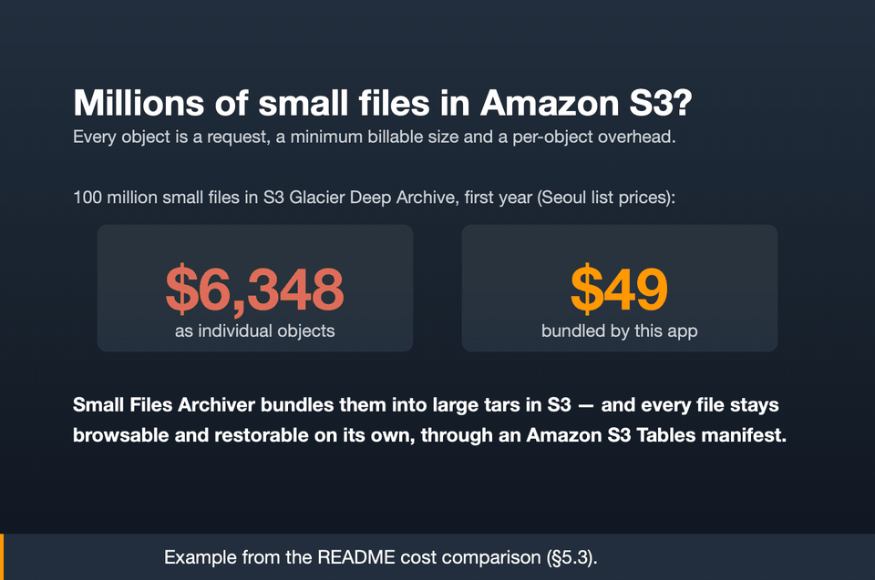
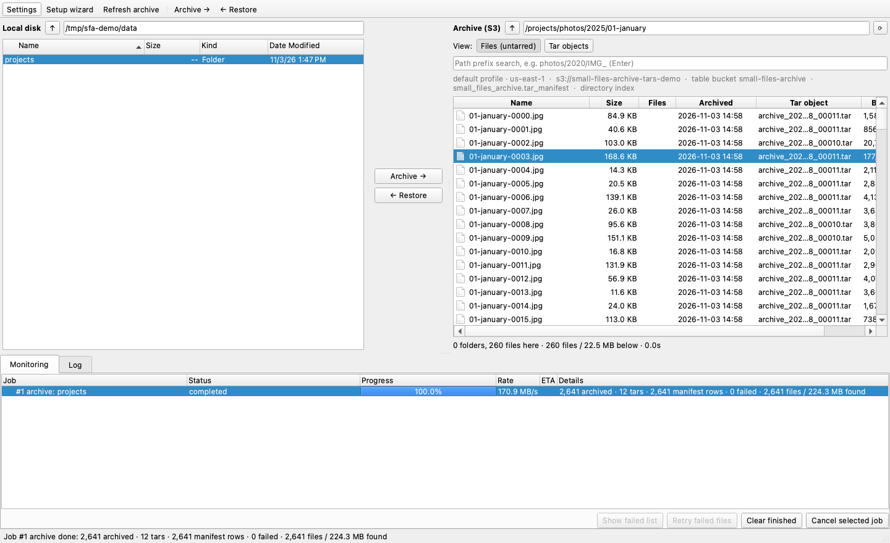
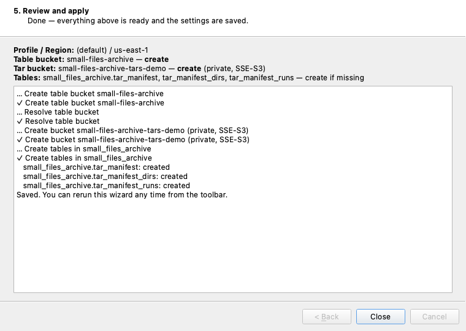
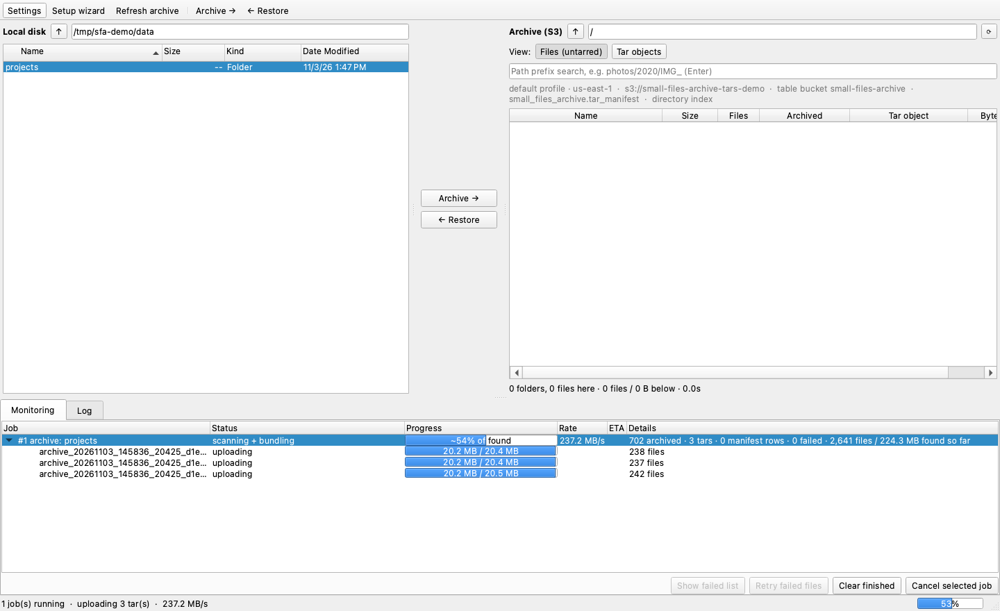

# Small Files Archiver → S3 + S3 Tables Manifest

> 🌐 **한국어**: [README-ko.md](README-ko.md) · This is the English document.

An archiving solution that **bundles** large numbers of small filesystem files into tar objects on Amazon S3, and records each file's location (which tar, which byte range) in an **Amazon S3 Tables (managed Apache Iceberg)** table.

Based on [aws-samples/small-files-archiving-solution](https://github.com/aws-samples/small-files-archiving-solution), this version moves the manifest from CSV objects to S3 Tables and reworks the internals with single-pass MD5, streaming tar, batched commits, and multiprocess parallelism.

<p align="center">
  <a href="gui/docs/demo.mp4"></a><br>
  <b>▶ Click the preview for the 1-minute intro video (MP4, recorded on AWS)</b>
</p>

## Desktop GUI — start here

The easiest way to use the solution is the desktop app in [`gui`](gui/README.md). **See the [GUI user guide](gui/README.md)** for every screen, step by step.



▶ **[1-minute intro](gui/docs/demo.mp4)**: why millions of small files cost so much, then setup, the two kinds of source (local disk or S3 bucket), archiving 482,980 objects from an S3 bucket on EC2, browsing as files or as tars, and restore. **[2-minute walkthrough](gui/docs/demo-walkthrough.mp4)**: archiving 523,124 files from a local disk, browsing, restore and an incremental run.

```bash
cd gui && ./run-gui.sh      # first run creates its own Python environment
```

1. **Set up:** a first-run wizard picks or creates the S3 Tables table bucket, the manifest tables and a private tar bucket, all by name, with no ARNs to look up. → [guide §2](gui/README.md#2-first-run-setup-wizard)
2. **Archive:** select folders on the left and click **Archive →**. Each tar in flight gets its own bundling or uploading bar. → [§4](gui/README.md#4-archive-files)
3. **Browse:** the right pane shows your **original files and folders**, with the tar and byte range of each file. Switch to **Tar objects** to see the tars themselves. → [§5](gui/README.md#5-browse-the-archive)
4. **Restore:** select files or folders on the right and click **← Restore**. Only the needed byte ranges are fetched, and MD5 is verified. → [§6](gui/README.md#6-restore-files)

Also in the GUI: [incremental runs](gui/README.md#7-incremental-archiving), [file-list reports as input](gui/README.md#8-archive-from-a-file-list-report) and [one-click retry of failed files](gui/README.md#9-failed-files-and-retry).

| Setup wizard | Archiving in progress |
|---|---|
|  |  |

The rest of this document covers the command-line archiver and restore scripts that the GUI runs underneath.

### Key features

- **Desktop GUI** — setup wizard, dual-pane browse (original files ↔ tar objects), archive/restore with per-tar progress, incremental runs, report input and retry of failed files. See above.
- **S3 bucket as a source** — archive the objects of a bucket/prefix, an S3 Inventory or an s3tar manifest with 256-way concurrent GETs, verifying each object against the checksum S3 stored for it. See §3.
- **File bundling** — packs many small files into large tar objects, cutting PUT requests and sidestepping the small-object storage penalty (e.g. Glacier IR 128 KB minimum billing).
- **S3 Tables manifest** — records every file's `tar_key` + byte range in a managed Apache Iceberg table, so an individual file stays locatable inside a tar.
- **Direct individual-file restore** — extracts a single file straight from its tar via byte-range GET, without downloading the whole tar (`fss3-restore.py`).
- **Two input modes** — walk a directory (`--src-path`), or archive an explicit `--input-file` list of files (from a DB export, `find`, or a change-list).
- **Per-file MD5 integrity** — every file is hashed (single-pass, `--md5`) and the digest is stored in the manifest, so restores can be verified byte-for-byte. Integrity checking is essential for an archive, so always enable it.
- **Multiprocess parallelism** — tar packing and upload run across worker processes, bypassing the GIL; manifest commits are batched to avoid Iceberg small-file/snapshot explosion.
- **Optional parallel file scanning** — the source tree can be enumerated by `--scan-threads` threads feeding a bounded queue, so a latency-bound network filesystem doesn't cap the whole pipeline at one thread's stat rate. Serial by default; opt in when the source is remote.
- **Safe concurrent runs** — several archiver runs can write to one manifest table at the same time, each with its own tar namespace. See [§6](#6-running-several-archivers-at-once).

> ⚠️ Not official AWS documentation. This is field-test material.

---

## 1. Overview

### Why bundle

Uploading an archive of tens-of-KB files — hundreds of thousands to billions of them — as individual S3 objects blows up two costs:

- **Request cost**: one PUT per file → millions to billions of PUTs.
- **Small-object penalty**: Glacier Instant Retrieval and Standard-IA have a **128 KB minimum billable size**; Glacier Flexible Retrieval and Deep Archive add a **40 KB per-object metadata overhead**. A tens-of-KB file is billed far above its real size.

Bundling files into large tars (e.g. 20 MB) cuts the object count by hundreds to thousands of times, so both costs effectively disappear. The remaining problem — how to find and retrieve an individual file inside a tar — is solved by a **manifest (a file → tar + byte-range index)**.

### Architecture

```
File source (directory walk of --src-path, or an explicit --input-file list)
   └─ K scanner threads (--scan-threads) enumerate in parallel
        │  each closes a batch at --max-size / --max-files and pushes it
        └─ bounded batch queue
             └─ main thread assigns the tar name and submits
                  └─ ProcessPoolExecutor (N worker processes)
                        │  each worker: build tar (optional MD5) + S3 multipart upload
                        │  → returns manifest rows
                        └─ single writer thread → batched commit to S3 Tables
                                                  (default 50,000 rows)
```

Script: `fss3-archiver-s3tables-mp.py` (multiprocess). CPU-bound work such as tar packing and MD5 runs in parallel across worker processes, bypassing the GIL; the scan runs on threads because it is latency-bound rather than CPU-bound.

Design points:

| Item | Approach | Why |
|---|---|---|
| MD5 | computed once while streaming into tar (optional) | avoids reading each file twice |
| tar buffer | `SpooledTemporaryFile` (spills to disk past a threshold) | prevents large tars from staying resident in RAM |
| byte offset | tar stream `tell()` position | real physical position including tar headers/padding → correct byte-range restore |
| file scan | K threads pulling directories off a shared queue | one `lstat` round-trip per entry is latency-bound; `getdents`/`lstat` release the GIL, so threads genuinely overlap the waiting |
| scan ↔ pack handoff | bounded queue, and the main thread drains whichever tar finished first | the walk keeps running while tars upload, instead of alternating with them; no single slow upload blocks the window |
| manifest write | a **single** writer per run commits in batches | keeps one run's commits serialized → minimal snapshot churn (concurrent *runs* are still safe, see [§6](#6-running-several-archivers-at-once)) |
| commit retry | full-jitter exponential backoff (`--commit-retries`) | a fixed backoff makes two conflicting writers collide again in lockstep |
| process start | `spawn` context | forking while the writer thread holds a lock would deadlock the child |
| S3 Tables connection | direct S3 Tables Iceberg REST endpoint | no Lake Formation setup required |

---

## 2. Installation

- **Python 3.9+** (tested on 3.12.1)
- A pre-created S3 bucket (for tars) and an S3 Tables table bucket (for the manifest). The namespace and table are created automatically (idempotent) by the script.

```bash
pip install -r archiver/requirements.txt   # boto3[crt]: fast CRC64NVME
# Test-verified: pyiceberg 0.11.1 / pyarrow 18.1.0 / boto3 1.39.17
# pyiceberg >= 0.12 needs the pyiceberg-core extra to append to the day-partitioned table (also verified: 0.12.0 / pyarrow 26.0.0 / boto3 1.43)
```

Required IAM permissions (manifest, S3 Tables direct endpoint):

```
s3tables:GetTableBucket, ListNamespaces, CreateNamespace, GetNamespace,
s3tables:ListTables, CreateTable, GetTable,
s3tables:GetTableMetadataLocation, UpdateTableMetadataLocation,
s3tables:PutTableData, GetTableData
+ s3:PutObject on the tar destination bucket
```

> Least-privilege example IAM policies (archiver, browse/restore, setup wizard): see the [GUI guide, IAM permissions](gui/README.md#iam-permissions).


---

## 3. Usage

Every run combines a **file source** (walk `--src-path`, or an explicit `--input-file` list) with a **batching rule** (`--max-size` or `--max-files`). The scenarios below all share the same destination/S3 Tables flags — only the source and batching choices change.

> 💡 [`archiver/run.sh`](archiver/run.sh) packages every scenario below (plus restore) as ready-to-run bash functions — edit the shared vars at the top, uncomment one call, and run `bash run.sh`.

**Baseline — bundle a directory into uniform-size tars (the common case):**

```bash
python archiver/fss3-archiver-s3tables-mp.py \
  --src-path         /data/nfsshare \
  --dst-bucket       your-own-dest-bucket \
  --dst-prefix       20260804 \
  --max-size         20MB \
  --num-workers      8 \
  --md5 \
  --region           ap-northeast-2 \
  --table-bucket-arn arn:aws:s3tables:ap-northeast-2:<account>:bucket/<table-bucket> \
  --namespace        small_files_archive \
  --table-name       tar_manifest \
  --batch-size       50000 \
  --tar-storageclass GLACIER_IR
```

The remaining scenarios are the baseline **with the noted flags changed**:

**Fixed file count per tar** — cap each tar at N files instead of a size:

```bash
  --max-files 1000          # replaces --max-size
```

**Archive an explicit list of files** — from a DB export, a `find` result, or a change-list, instead of walking the tree:

```bash
  --input-file files-to-archive.txt --max-files 1000
```

One absolute path per line (blank lines and `#` comments skipped). Missing or unreadable paths are counted as failed and go to the failed-file list; symlinks and non-regular files are skipped. Neither stops the run. CSV/TSV reports work too — see `--input-format` / `--path-column`. `--src-path` is still required — it's the base for each tar member's relative path. Paths must resolve inside `--src-path` (symlinked parent folders and `..` are resolved first); anything outside is refused and listed as failed, unless you pass `--allow-outside-src` (then it is stored as the full path with the leading `/` dropped). For lists made with `find -print0`, use `--input-format nul`, which is safe for any file name.

**Cold, write-once data — compress:**

```bash
  --compress --tar-storageclass DEEP_ARCHIVE
```

⚠️ `--compress` disables byte-range individual restore (offsets recorded as `-1`), and `DEEP_ARCHIVE` requires a whole-tar restore before any read — pair them only for archives you don't expect to read back file-by-file. See [Limitations](#limitations-and-notes).

Restoring a single file back out is covered in [§4.2](#42-restore--extract-an-individual-file-via-byte-range-get) (LOOKUP by path, or DIRECT by known offsets).

### Archive from an S3 bucket (`s3s3-archiver-s3tables-mp.py`)

The same pipeline, manifest, browser, restore, incremental, Resume and failed-file list work with an **S3 bucket as the source**. Use it for buckets full of small objects that are expensive to store or to move to colder classes one object at a time.

> ⚠️ **Run it in the source bucket's Region, not on your laptop.** Every byte the archiver reads from S3 into a computer outside AWS is billed as **S3 data transfer out**. That's about $0.126/GB in Seoul for the first 10 TB a month: roughly **$129 per TB**, or about **$1.3 million for 10 PB**. On EC2 (or CloudShell) in the same Region the reads cost nothing beyond the GET requests, and they're several times faster. Use a public subnet or an S3 Gateway VPC endpoint: a NAT Gateway bills about $0.059/GB. The GUI repeats this warning when **Run on** is *This computer*. See [Running on EC2: two ways](#running-on-ec2-two-ways).

```bash
python archiver/s3s3-archiver-s3tables-mp.py \
  --src-s3           s3://source-bucket/data/fs1/ \
  --src-prefix       data/ \
  --dst-bucket       your-own-dest-bucket \
  --dst-prefix       s3-archive \
  --max-size         256MB \
  --num-workers      8 \
  --get-concurrency  256 \
  --region           ap-northeast-2 \
  --table-bucket-arn arn:aws:s3tables:ap-northeast-2:<account>:bucket/<table-bucket>
```

| Option | Meaning | Default |
|---|---|---|
| `--src-s3 s3://bucket/prefix` | archive every object below the prefix: a parallel `ListObjectsV2` walk, split on `/` | — |
| `--src-manifest FILE` | archive the objects listed in an **s3tar CSV** (`bucket,key,size[,etag]`), an **S3 Inventory** `manifest.json` (CSV or Parquet), or one `s3://bucket/key` per line (the failed-file list); local path or `s3://` | — |
| `--src-prefix` | store keys relative to this prefix: the listed prefix (default), a parent (`data/` keeps `fs1/…`), or `""` for the full key | listed prefix |
| `--get-concurrency` | concurrent source GETs in total, spread over `--num-workers` processes | 256 |
| `--get-client` | client for source GETs of objects under 32 MiB: `crt` (the AWS CRT S3 client, native code) or `boto3`. Larger objects always stream through boto3 | `crt` |
| `--list-threads` | parallel listing / HeadObject threads | 16 |
| `--verify-source-checksum` | compare each object's bytes with the full-object checksum S3 stored for it (CRC64NVME, CRC32C, CRC32, SHA256 or SHA1); a mismatch fails that object | on |
| `--src-region` | Region of the source bucket | `--region` |

All destination, bundling, upload, manifest, `--incremental` (by LastModified), `--resume-run` and `--part-size` options are the same as for the local archiver.

**Where the time goes.** Small objects make the job **GET-bound**: one request per object at about 10–20 ms each inside the Region. That's why each worker fetches its batch with many concurrent GETs and writes the tar in order. S3 serves about 5,500 GETs/s per prefix partition, and retries with backoff and jitter absorb `503 SlowDown` responses.

With boto3, profiling showed the **CPU, not the network**, as the limit: about 60% of it went to botocore's per-request work (an adaptive-retry rate limiter, `Last-Modified` parsing, HTTP and TLS in Python), while checksum validation took about 5%. The default `--get-client crt` sends each small-object GET through the AWS CRT S3 client, which signs, sends and receives in native code. It is still one plain GET per object, so S3 returns the same full-object checksum header and the CRC64NVME comparison is unchanged.

Measured on EC2 in `ap-northeast-2` (Amazon Linux 2023, through SSM), 523,124 objects (9.95 GiB), exactly one GET per object, every checksum verified, 0 failures:

| Instance | Client | Workers / GETs | Throughput |
|---|---|---|---|
| m5.2xlarge (8 vCPU) | boto3 (before) | 8 / 256 | 35.5 MB/s |
| m5.2xlarge | crt | 8 / 256 | 77.8 MB/s |
| m5.2xlarge | crt | 16 / 512 | 92.0 MB/s |
| c6in.8xlarge (32 vCPU) | crt | 32 / 1024 | 167.5 MB/s |
| c6in.8xlarge | crt | 48 / 1536 | **180.8 MB/s** |

Throughput grows with vCPUs. A good starting point is vCPU + 16 workers (at most 2 per vCPU) and 32 GETs per worker; the GUI fills these in when you pick an instance. The fs1 runs were only about a minute long on the c6in, so startup and listing ramp-up are part of these averages.

**Checksums.** CRC64NVME is computed while each object streams into its tar and stored in S3's own encoding, so it can be compared directly with the source object's `x-amz-checksum-crc64nvme` or an **S3 Batch Operations "compute checksum"** report. S3 adds a full-object CRC64NVME to new uploads by default. In the test, all 523,124 objects carried one, and a 2,000-object sample matched exactly. Objects that carry only a *composite* (multipart) checksum can't be compared byte-for-byte and are archived without that comparison.

#### Running on EC2: two ways

Both start from the GUI's **Archive from S3** dialog and run exactly the archiver version the GUI is using: it is uploaded to `s3://<tar bucket>/_sfa/runner/<version>/`, and the instance installs it once into a private Python 3.12 environment (prebuilt wheels only).

| | **A. Run on EC2 via SSM** (recommended) | **B. Copy the script and run it yourself** |
|---|---|---|
| How | Set **Run on** to the instance, then **Start archiving** | Click **Copy script for EC2**, then paste it into a terminal on the instance (SSH, Session Manager or EC2 Instance Connect) |
| Needs | The instance is Online in Systems Manager; your GUI user may `ssm:SendCommand` to it | Only a shell on the instance |
| Progress | Live bars, rate, ETA and log in the GUI; it reattaches after you close and reopen the GUI | `tail -f` the log file the script prints |
| Cancel / Resume | Buttons in the GUI | `kill -INT <pid>` (a clean cancel); paste the script again with `RESUME_OF=<run id>` |
| Good for | Day-to-day runs | No SSM access, scheduled runs, CloudShell, or several instances that each archive their own part of the source |

- **Instance role:** the archiver permissions (see the [GUI guide, IAM](gui/README.md#iam-permissions)) plus `s3:GetObject` on `_sfa/runner/*` in the tar bucket. For A, also `s3:PutObject` on `_sfa/jobs/*` (progress) and `AmazonSSMManagedInstanceCore`.
- **Size:** about vCPU + 16 workers (at most 2 per vCPU) and 32 GETs per worker; the dialog fills these in for the instance you pick (see the table above).
- **Network:** a public subnet or an S3 Gateway VPC endpoint, never a NAT Gateway.
- **Without the GUI:** on the instance, `pip install -r archiver/requirements.txt` and run the command shown at the top of this section.

Step-by-step for both: [GUI guide, Run on EC2](gui/README.md#run-on-ec2-no-data-transfer-out).

Objects in GLACIER or DEEP_ARCHIVE are reported as failed with "restore it in S3 first". Folder markers are skipped. Keys that can't be used as a relative path, such as `../x`, are refused. The source is never modified or deleted.

Extra IAM for the source: `s3:ListBucket` on the source bucket (with an `s3:prefix` condition), `s3:GetObject` on `arn:aws:s3:::<source-bucket>/<prefix>*`, and `s3:GetObject` on the inventory bucket if you use `--src-manifest` with S3 Inventory.

### Key parameters

| Parameter | Description | Default |
|---|---|---|
| `--src-path` | source directory to archive (recursed); with `--input-file`, the base used to compute each file's relative path | (required) |
| `--input-file` | text file listing files to archive (one path per line; `#` comments and blank lines skipped) instead of walking `--src-path` | off (walk) |
| `--dst-bucket` / `--dst-prefix` | S3 bucket / prefix for tars | (required) |
| `--max-size` **or** `--max-files` | per-tar size (e.g. `512MB`) or file count (pick one) | (required) |
| `--num-workers` | tar-build/upload worker processes | `os.cpu_count()` |
| `--scan-threads` | threads enumerating the source tree (see below) | 1 |
| `--run-id` | token in tar names / log filename that keeps concurrent runs apart | `<timestamp>_<pid>_<rand>` |
| `--md5` | compute and store per-file MD5 for integrity verification | on (default) |
| `--region` | AWS region | (required) |
| `--table-bucket-arn` | S3 Tables table bucket ARN | (required) |
| `--namespace` / `--table-name` | manifest namespace / table | small_files_archive / tar_manifest |
| `--batch-size` | rows per manifest commit | 50000 |
| `--flush-interval` | seconds before a partial manifest batch commits anyway | 15 |
| `--commit-retries` | attempts per manifest commit before the run aborts | 8 |
| `--dir-index` / `--no-dir-index` | maintain the `<table-name>_dirs` directory index and the manifest `parent_dir` column so the GUI can list one folder at a time at billion-file scale (adds `parent_dir` to an existing table by additive schema evolution) | on |
| `--walk-path` | walk only this directory/file under `--src-path` (repeatable); paths stay relative to `--src-path`, so `--src-path /data --walk-path /data/photos` stores `photos/...` | off |
| `--progress` | print JSON progress snapshots to stdout (lines prefixed `@@PROGRESS `); used by the GUI | off |
| `--incremental` | archive only files whose mtime **or** ctime is newer than the start of the last successful (`ok`/`partial`) run of the **same source** (same `--src-path` + `--walk-path` set), read from `<table-name>_runs`. ctime catches renames/moves. The first run of a source archives everything. Not combinable with `--input-file` | off |
| `--watermark-skew` | seconds subtracted from the incremental watermark for clock differences between hosts / the file server; files in the overlap are re-archived, never missed | 300 |
| `--input-format` | `--input-file` format: `lines` (one path per line), `nul` (NUL-separated, from `find -print0`), `csv`, `tsv` (a file-list report); `auto` picks by extension; `.gz` is read transparently | auto |
| `--resume-run` | continue an interrupted (cancelled or failed) run: the same source is archived again, skipping every file that run already archived, so nothing is missing or duplicated. Repeat it for a chain of resumes. Keeps a set of the run's file names in memory (~100 B per file). GUI: **Resume** | — |
| `--allow-outside-src` | accept `--input-file` paths that resolve outside `--src-path` (off by default, so a list can't pull in files from elsewhere on the host) | off |
| `--path-column` | csv/tsv report column with the path: header name (e.g. `path`) or 0-based index. Relative paths resolve against `--src-path` | 0 |
| `--run-history` / `--no-run-history` | record every run (status, counts, watermark, failed-list location) in `<table-name>_runs`; required by `--incremental` | on |
| `--tar-storageclass` | storage class for tar objects (see below) | STANDARD |
| `--part-size` | multipart upload part size, also the single-PUT threshold: `8MB`, `16MB`, `32MB`, `64MB`. Every part is a billed request; see §5.3 | 32MB |
| `--upload-client` | client for tar uploads: `crt` (AWS CRT S3 client, native TLS and multipart) or `boto3`. Both send a CRC64NVME checksum that S3 checks on every request | `crt` |
| `--verify-tar-upload` / `--no-verify-tar-upload` | after each upload, compare the full-object CRC64NVME S3 stored for the tar with the CRC64NVME of the bytes that were packed (one HeadObject per tar, needs `s3:GetObject` on the tars). A mismatch fails the tar and records none of its rows | on |
| `--tar-layout` | folder level for tars under `--dst-prefix`: `run` = `<prefix>/<run-id>/` (one folder per run, so each full or incremental run can be checked, reconciled or cleaned up as a unit), `date` = `<prefix>/<YYYYMMDD>/` (the earlier layout), `flat` = `<prefix>/`. Existing archives keep working: the manifest stores full tar keys | run |
| `--spool-max-mb` | in-memory threshold for a tar (spills to disk above it) | 256 |
| `--compress` | gzip the tar (⚠️ see limitations) | off |

**Failed files and retry.** Every file that could not be archived — stat errors, unreadable files, and every file of a tar whose upload failed — is streamed to `logs/<dst-prefix>/failed_<run-id>.txt`, one absolute path per line. A `.tsv` next to it holds the reasons. Retry with the same settings:

```bash
python archiver/fss3-archiver-s3tables-mp.py --src-path <same base> \
  --input-file logs/<dst-prefix>/failed_<run-id>.txt ...   # same parallel pipeline
```

Symlinks and special files are counted as **skipped**, not failed, and are not listed: retrying them would only skip them again. A run ends `ok` (no failures), `partial` (some failed — still advances the incremental watermark; retry the list) or `failed`.

Storage layout: tars go to `s3://<bucket>/<prefix>/<run-id>/archive_<run-id>_<NNNNN>.tar` by default (`--tar-layout run`; `date` puts them under `<YYYYMMDD>/` as before, `flat` directly under the prefix); the manifest is written to the S3 Tables table.

> ⚠️ With incremental runs, an older run folder still holds every file that has not changed since — delete run folders only for failed or cancelled runs, never to "clean up" a successful one.

#### `--scan-threads`

Enumerating small files costs one `lstat` round-trip per entry, so on a network filesystem the walk is **latency-bound, not CPU-bound** — a single thread caps out around 500–2,000 files/s no matter how many worker processes are packing tars. Threads help because `getdents`/`lstat` release the GIL.

**The default is 1 (serial walk).** Threads exist to hide latency, so they only pay off when there is latency to hide — and whether there is depends entirely on your source. Measured against a simulated 1 ms-per-entry stat (a cold-cache NFS shape) scaling is close to linear:

| `--scan-threads` | 1 | 4 | 8 | 16 | 32 |
|---|---|---|---|---|---|
| speedup (1 ms/entry simulated) | 1.0x | 4.1x | 8.0x | 16.2x | 30.0x |

On a **local NVMe** tree of 523,124 files with the page cache dropped before each measurement, the same code behaves very differently — 30,120 files/s serial, a 1.9x peak at 4 threads, and flat past 8:

| `--scan-threads` | 1 | 2 | 4 | 8 | 16 | 32 |
|---|---|---|---|---|---|---|
| speedup (local NVMe, cold) | 1.0x | 1.6x | **1.91x** | 1.54x | 1.54x | 1.54x |

And in four cold end-to-end 1M-file runs, total wall time was **unchanged** between 1 and 8 scan threads (57.3–58.5 MB/s in every case) — the volume's IOPS budget was the wall, not the walk. That is why the default is 1: a serial walk is the predictable baseline, and raising it is an opt-in for sources that are genuinely latency-bound (NFS/SMB over a network, cross-AZ, cross-region). Measure your mount's actual ceiling first; the server or the NFS RPC slot limit may cap it well before the thread count does:

```bash
# serial enumeration cost
sudo sh -c 'echo 3 > /proc/sys/vm/drop_caches'
time find /data/nfsshare -type f -printf ''

# same work fanned out over top-level subdirectories
sudo sh -c 'echo 3 > /proc/sys/vm/drop_caches'
time ls -d /data/nfsshare/*/ | xargs -P 8 -I{} find {} -type f -printf ''
```

If the two times are the same, the filesystem is the wall and more scan threads won't help.

#### `--tar-storageclass` values

The value is passed straight through to S3 `PutObject`, so any S3 storage class is accepted. For this solution the one that matters is **whether individual-file restore (§4.2) works immediately or needs a whole-tar restore first**:

| Class | Individual restore (§4.2) | Notes |
|---|---|---|
| `STANDARD` | ✅ immediate | **default.** No minimum storage duration and no retrieval fee, so nothing surprises you on a first run — but the most expensive per GB to keep. |
| `GLACIER_IR` | ✅ immediate | Glacier Instant Retrieval — archive pricing with millisecond ranged GET. **The right choice for a real cold archive**, at the cost of a 90-day minimum storage duration and a per-GB retrieval fee. |
| `STANDARD_IA` / `ONEZONE_IA` | ✅ immediate | infrequent access; per-GB retrieval fee. `ONEZONE_IA` is single-AZ (cheaper, lower durability). |
| `INTELLIGENT_TIERING` | ✅ immediate* | auto-tiers by access. *Ranged GET is immediate unless an object has moved to the optional Archive Access tiers. |
| `GLACIER` (Flexible Retrieval) | ⚠️ restore first | cheaper storage, but §4.2 fails until you restore the whole tar (minutes–hours). |
| `DEEP_ARCHIVE` | ⚠️ restore first | cheapest storage; whole-tar restore takes up to ~12 h. |

> **Rule of thumb:** the default `STANDARD` is the safe starting point — no minimum duration, no retrieval fee, nothing to regret on a test run. Once you know the data really is cold, `GLACIER_IR` is the one to set: far cheaper per GB and still immediate single-file restore. Only move to `GLACIER` / `DEEP_ARCHIVE` when the data is truly write-once and you accept a restore delay for the whole tar. Classes like `REDUCED_REDUNDANCY`, `EXPRESS_ONEZONE`, `OUTPOSTS`, `SNOW`, and `FSX_*` exist in the API but are not meaningful for this archiving workflow.

#### `--max-files` (`--max-size`) vs `--batch-size`

These two look similar but control **different stages** and never interact:

| Option | What it splits | Stage | Effect |
|---|---|---|---|
| `--max-files` / `--max-size` | files → **tar bundle** | upload (input) | number/size of **tar objects** in S3 |
| `--batch-size` | manifest rows → **one commit** | S3 Tables write (output) | number of Iceberg **commits (snapshots)** |

- **`--max-files` / `--max-size`** — how many files (or how many bytes) go into one tar. The scanner cuts a new tar when the running count/size hits the limit. Pick exactly one. This determines the size of each S3 tar object (and thus your PUT-request and small-object savings). Size-based (`--max-size 20MB`) is usually preferred so objects stay uniform even when file sizes vary.
- **`--batch-size`** — how many manifest rows (**one row per file**, not per tar) the single writer accumulates before appending to S3 Tables. Default 50,000. Small values create frequent commits → many small files / snapshots in the manifest → slower queries, so keep it large for big runs.

Worked example — 1M files:

```
--max-files 1000    → ~1,000 tar objects        (S3 object count)
--batch-size 50000  → ~21 manifest commits      (Iceberg snapshot count)
```

Think of it as: `--max-files` decides how many **boxes** you pack the files into; `--batch-size` decides how many **packing-list rows** you record per ledger entry. Changing one does not change the other.

### Manifest schema (S3 Tables)

| Column | Type | Description |
|---|---|---|
| `tar_key` | string | S3 key of the tar containing the file |
| `source_key` | string | original file relative path |
| `byte_start` / `byte_end` | long | byte range within the tar (for Range GET) |
| `md5` | string | MD5 of the original file (computed by default; null only if disabled) |
| `filesize` | long | original file size |
| `archive_ts` | timestamptz | archive time (partition: `day(archive_ts)`) |
| `parent_dir` | string | directory of `source_key` (`''` at the root); written with `--dir-index`, null on rows from before it existed |

A companion table `<table-name>_dirs` (`parent_dir`, `dir_path`, `files`, `bytes`, `archive_ts`, `run_id`) holds per-commit **recursive** file/byte totals for every directory touched. Summing rows per `dir_path` gives folder totals; a path archived in several runs is counted once per run.

---

## 4. Search and restore

### 4.1 Search — Athena or PyIceberg

```sql
SELECT tar_key, byte_start, byte_end, md5
FROM small_files_archive.tar_manifest
WHERE source_key LIKE '%file0499%'
  AND archive_ts BETWEEN TIMESTAMP '2026-08-04' AND TIMESTAMP '2026-08-05';
```
> To query with Athena, the table bucket must have AWS analytics services (Glue Data Catalog) integration enabled. You can also query directly with PyIceberg (see 4.2).

### 4.2 Restore — extract an individual file via byte-range GET

Use `fss3-restore.py`. It fetches only the byte range holding the file — the archiver records `byte_start` at the file's tar header and `byte_end` at the end of its padding, so that range is a self-contained single-member tar that `tarfile` opens directly. No full-tar download.

**Note:** the manifest stores `tar_key` but **not** the bucket, so `--tar-bucket` is always required.

**DIRECT mode** — you already have the offsets (e.g. from the 4.1 query):

```bash
python archiver/fss3-restore.py \
  --tar-bucket       your-own-dest-bucket \
  --tar-key          20260804/20260804/archive_20260804_120000_31417_a3f1_00001.tar \
  --byte-start       1536 \
  --byte-end         21503 \
  --out              ./restored/file0499.dat
```

**LOOKUP mode** — you only know the original path; the script queries the manifest (exact `source_key` match with Iceberg predicate pushdown — no full-table scan) and resolves the offsets itself:

```bash
python archiver/fss3-restore.py \
  --region           ap-northeast-2 \
  --table-bucket-arn arn:aws:s3tables:ap-northeast-2:<account>:bucket/<table-bucket> \
  --namespace        small_files_archive \
  --table-name       tar_manifest \
  --source-key       sub/file0499.dat \
  --tar-bucket       your-own-dest-bucket \
  --out-dir          ./restored/ \
  --verify-md5
```

`--out` writes to an exact path; `--out-dir` preserves the file's archived relative path underneath. `--verify-md5` (LOOKUP) checks the extracted bytes against the manifest MD5; in either mode `--verify-md5 <hex>` checks an explicit value. If a `source_key` matches more than one row (same path archived in multiple runs), LOOKUP picks the newest `archive_ts` and warns — query 4.1 and use DIRECT with an explicit `--tar-key` to pick a specific one.

**Storage-class caveats:** this works with no wait on `STANDARD` (the default), `GLACIER_IR`, and the IA classes. **If the tar is in Glacier Flexible Retrieval / Deep Archive, you must first restore the entire tar (hours) before a ranged GET succeeds** — the script detects this and errors clearly. Files archived with `--compress` have offsets of `-1` and cannot be range-restored; extract the whole `.tar.gz` instead.

---

## 5. Performance and cost (measured in the test environment)

Test environment: EC2 (Amazon Linux, 8 vCPU, ap-northeast-2), source = NFS `/data/nfsshare` (avg ~19 KB/file), Python 3.12.1.

### 5.1 Throughput

1M files (fs1+fs2, 19.49 GB), 8 workers, MD5 on:

| Elapsed | Rate | Failures |
|---|---|---|
| 89.0s | 224.3 MB/s | 0 |

Single-pass hashing adds no extra read (the bytes are already being read to build the tar), so per-file MD5 is inexpensive on this transfer/I/O-dominated workload.

### 5.2 Object consolidation and request reduction

For the 1M-file run:

| Approach | Object PUTs | Consolidation |
|---|---|---|
| Individual upload | 1,006,108 | — |
| **Bundling (this solution)** | **1,000** (979 tars + 21 manifest commits) | **~1,028 : 1** |

→ About **1,000× fewer** PUT requests. Since each tar is 20 MB, it also avoids the 128 KB minimum-billing penalty of GLACIER_IR / IA entirely if you move the tars there.

### 5.3 Cost comparison: individual objects vs bundled tars

Prices are AWS list prices for **Asia Pacific (Seoul, ap-northeast-2)**, read from the AWS Price List API on 2026-11-03, excluding tax and free tier. Check current prices for your Region before deciding.

**Example data:** 523,124 files, 9.9 GiB. The average file is 19.9 KiB, and every file is under 128 KiB, which is typical of the small-file archives this solution targets. Bundled means 256 MB tars uploaded with 32 MB parts (≈ 42 tars). Tar headers and padding add 3.8 % to the stored bytes. The S3 Tables manifest is about 34 bytes per file (17 MiB here) and is included in the bundled storage figure.

| Storage class | | Upload requests | Upload (one time) | Billed storage | Storage / month | First year |
|---|---|---|---|---|---|---|
| STANDARD | individual files | 523,124 | $2.35 | 9.9 GiB | $0.249 | $5.34 |
| | **bundled tars** | **415** | **$0.0019** | 10.3 GiB + 17 MiB manifest | **$0.259** | **$3.10** |
| GLACIER_IR | individual files | 523,124 | $10.46 | 63.9 GiB | $0.319 | $14.29 |
| | **bundled tars** | **415** | **$0.0083** | 10.3 GiB + 17 MiB manifest | **$0.052** | **$0.633** |
| DEEP_ARCHIVE | individual files | 523,124 | $31.39 | 29.9 GiB | $0.152 | $33.21 |
| | **bundled tars** | **415** | **$0.0042** | 10.3 GiB + 17 MiB manifest | **$0.021** | **$0.258** |

**The same data scaled to 100 million files (1.9 TiB):**

| Storage class | | Upload (one time) | Storage / month | First year |
|---|---|---|---|---|
| STANDARD | individual / **bundled** | $450.00 / **$0.36** | $47.54 / **$49.42** | $1,020 / **$593** |
| GLACIER_IR | individual / **bundled** | $2,000.00 / **$1.58** | $61.04 / **$9.96** | $2,732 / **$121** |
| DEEP_ARCHIVE | individual / **bundled** | $6,000.00 / **$0.79** | $28.98 / **$4.04** | $6,348 / **$49** |

**Where the difference comes from:**

- **Upload requests.** Every individual file is a PUT, so 1,260× more requests than 415 for the tars. PUT prices also rise with the class: $0.0045 per 1,000 requests for STANDARD, $0.02 for GLACIER_IR, $0.06 for DEEP_ARCHIVE in Seoul.
- **Minimum billable size.** GLACIER_IR (and STANDARD_IA / ONEZONE_IA) bills every object as at least 128 KiB. Here that turns 9.9 GiB into 63.9 GiB billed as individual files. Tars are far above the minimum.
- **Per-object overhead.** GLACIER and DEEP_ARCHIVE add 40 KiB per object: 32 KiB at the archive rate plus 8 KiB at the STANDARD rate. For 20 KiB files that triples the billed size. 42 tars add 1.6 MiB in total.
- **STANDARD storage is slightly higher when bundled** (tar padding plus the manifest), but the request savings outweigh it from the first upload.
- **Lifecycle transitions** cost per object. Moving 523,124 individual objects from STANDARD to GLACIER_IR later costs $10.46, while 42 tars cost < $0.001.
- **Restores.** Restoring a 503-file folder takes 503 GETs as individual objects and **1 ranged GET** from the tar (measured; nearby byte ranges are merged). GET-request savings are small per restore. The per-GB retrieval fee of GLACIER_IR is the same either way.

#### Upload part size (`--part-size`, GUI: *Upload part size*)

Each multipart part is a billed PUT-class request, so larger parts mean fewer requests. For the example data in GLACIER_IR:

| Part size | Requests per 256 MB tar | Requests (523k files) | Upload cost | Upload cost for 100 M files |
|---|---|---|---|---|
| 8 MB | 34 | 1,406 | $0.028 | $5.38 |
| 16 MB | 18 | 745 | $0.015 | $2.85 |
| **32 MB (default)** | **10** | **415** | **$0.0083** | **$1.59** |
| 64 MB | 6 | 250 | $0.0050 | $0.96 |

- **When the part size matters:** it changes the upload cost by up to 5.6×. That's small next to the savings from bundling itself, but it adds up at petabyte scale.
- **Costs of larger parts:** more memory (about part size × `--upload-concurrency` per worker), less parallelism within one tar, and more data re-sent when a part fails.
- **GLACIER and DEEP_ARCHIVE:** `UploadPart` and `CreateMultipartUpload` are billed at the STANDARD request rate; only `CompleteMultipartUpload` (or a single `PutObject`) pays the archive-class rate.
- **Small tars:** a tar no larger than one part is uploaded as a single PUT.

Not included: data transfer, S3 Tables maintenance (compaction at $0.005 per GB processed and $0.00175 per 1,000 objects, plus monitoring of the manifest's data files: cents at this scale), Athena queries, and minimum storage durations (30 days STANDARD_IA, 90 days GLACIER_IR / GLACIER, 180 days DEEP_ARCHIVE). Those minimums apply to whatever you store, bundled or not.

### 5.4 Integrity verification

Files were sampled from the first, middle, and last tars and restored from the actual tar via byte-range GET using the offset in the S3 Tables manifest. **Filename, size, and MD5 all matched.** The correctness of single-pass MD5 and physical tar offsets was confirmed against real S3.

`fss3-restore.py` itself was also verified end-to-end against real S3 + S3 Tables (a 523,123-row manifest, MD5 on). Both **DIRECT** and **LOOKUP** modes restored individual files via byte-range GET; the extracted bytes matched the manifest MD5 and were **byte-identical (`cmp`) to the originals**. Failure paths behaved correctly too — a wrong `--verify-md5`, a missing `source_key`, and specifying both modes at once each exited non-zero with a clear message.

---

## 6. Running several archivers at once

Running one archiver per source directory, all writing into the **same** manifest table, is supported.

### Is the manifest still consistent?

Yes. Amazon S3 Tables explicitly supports concurrent writers to a single table ([S3 FAQs](https://aws.amazon.com/s3/faqs/)), and this workload is the case Iceberg handles best:

1. **Commits are atomic.** A worker writes its Parquet data files first, then the catalog swaps the table's metadata pointer conditionally on the base snapshot. Exactly one writer wins a given race; the loser gets a commit conflict and nothing is half-applied. Readers only ever see a complete snapshot.
2. **Append-only writes never logically conflict.** This solution only appends — no deletes, no overwrite, no MERGE. A losing commit just re-reads the latest metadata and retries; its already-written data files stay valid. (Parallel `DELETE`/`UPDATE` on the same files is the case that produces hard commit errors — not applicable here.)
3. **Retries are jittered.** `--commit-retries` (default 8) uses full-jitter exponential backoff, so two conflicting writers don't back off by the same amount and collide again.

### What you must get right

**Give each run a distinct tar namespace.** Tar keys are `<prefix>/<run-id>/archive_<run-id>_<NNNNN>.tar` (or `<YYYYMMDD>/` / no folder with `--tar-layout date|flat`), and `--run-id` defaults to `<timestamp>_<pid>_<rand>` — unique per process, so the default is already safe even for runs launched in the same second from a shell loop. Only override `--run-id` if you need a reproducible name, and never reuse one value for two live runs sharing a `--dst-prefix`: they would overwrite each other's tars, leaving manifest rows pointing at a tar that no longer holds those files.

**Keep `--src-path` the same across the runs, and split the work with `--input-file`.** `source_key` is stored *relative to that run's `--src-path`*, so giving each run a different subtree as its `--src-path` makes the relative paths collide: three runs over `fs1/`, `fs2/`, `fs3/` all record `f000.dat`, and there is no longer anything in the row that says which subtree it came from. Measured on a 210-file, 4-run test: 210 rows but only **60 distinct `source_key`** — reconciliation undercounts by 150, and a LOOKUP restore for `f000.dat` is ambiguous between subtrees. Point every run at the common parent and hand each one a list instead:

```bash
# safe: one shared --src-path, so source_key stays globally unique;
# each run gets its own run_id automatically.
for sub in fs1 fs2 fs3; do
  find /data/nfsshare/$sub -type f > /tmp/list.$sub
  python3 archiver/fss3-archiver-s3tables-mp.py \
      --src-path /data/nfsshare --input-file /tmp/list.$sub ... &
done
wait
```

The trade-off is that `--input-file` enumerates up front instead of streaming, so each `find` must finish before its run starts packing — on a slow mount that serial prefix can cost more than the concurrency wins. If you would rather keep the streaming walk, use per-subtree `--src-path` but treat the manifest as per-subtree too: keep the runs in **separate tables** (or separate `--namespace`s), because within one table their `source_key`s are no longer distinguishable.

**Pre-create the namespace and table once** before launching, so the runs don't race on creation:

```bash
python3 archiver/fss3-archiver-s3tables-mp.py --src-path /empty/dir --max-files 1 ...  # creates ns + table
```

**Watch the commit rate.** Each run commits every `--batch-size` rows or `--flush-interval` seconds, whichever comes first. With many runs on one table, raise `--flush-interval` to cut the commit rate — and with it both the conflict probability and the snapshot churn. The run summary reports `N commits (M commit retries)`; `M` is your conflict gauge, and `manifest-writer: append failed` warnings in the log are the same signal live.

**Reconcile with `DISTINCT`.** If an append succeeds server-side but the response is lost, the retry re-appends the same rows. Those duplicates are harmless for restore (identical `tar_key` and byte range) but they inflate row counts, so verify with `COUNT(DISTINCT source_key)` rather than `COUNT(*)`. This only holds if `source_key` is globally unique — i.e. the runs share one `--src-path`, per the point above.

### Is more concurrency the right fix for slow throughput?

Often not. Concurrency only helps if the bottleneck is something each run gets its own copy of. If it is per-run software — one writer thread, one process's worth of packing — more runs help. If it is the **source device**, they don't: N runs share one IOPS budget, so they split the same ceiling N ways.

That is worth checking before you build a fan-out. In four cold 1M-file runs on a 200 GB gp2 volume (600 baseline / 3,000 burst IOPS, ~20 KB average file) throughput sat at 57.3–58.5 MB/s no matter what `--num-workers` or `--scan-threads` was set to; 3,000 IOPS × 20 KB ≈ 62 MB/s, i.e. the run was already at the device ceiling. The same tree warm was 222.90 MB/s. When the numbers look like that, the lever is the volume (gp3 with provisioned IOPS, io2, instance-store NVMe) — not more archivers, and not more scan threads.

If the source really is latency-bound (a network mount, not a local disk), raising `--scan-threads` within a single run addresses that bottleneck without N concurrent writers — see [`--scan-threads`](#--scan-threads). Measure the mount's ceiling first.

---

## Limitations and notes

- **With `--compress` (gzip), byte-range individual restore does not work.** Offsets are recorded as `-1` when compressing. Disable compression (plain tar) if you need individual-file restore.
- **For millisecond individual-file restore, keep tars in `STANDARD` (the default), `GLACIER_IR`, or an IA class.** Glacier Flexible Retrieval / Deep Archive require restoring the whole tar first (hours).
- **If you need Object Lock (WORM), configure versioning + Object Lock on the tar destination bucket separately.** (S3 Tables table buckets do not support Object Lock.)
- **Throughput depends on network bandwidth.** For on-premises → S3 transfers, bandwidth is likely the bottleneck.
- **For large runs, keep `--batch-size` large** (default 50,000). Small values create many small files in the manifest and can slow queries.
- **Tar upload and manifest commit are not atomic.** If the process crashes after a tar uploads but before its rows commit to S3 Tables, that tar is an orphan — archived but not findable/restorable. To detect orphans after a run, reconcile the tar objects under the destination prefix against the distinct `tar_key` values in the manifest.
- **On Amazon Linux / RHEL / SUSE, pyarrow's S3 client (which writes the manifest) can fail TLS with `curlCode: 60`** because it expects the Debian CA path. The archiver sets `SSL_CERT_FILE` to the system bundle automatically. It also checks that the manifest is reachable before uploading the first tar, so a broken trust store stops the run with no orphan tars. To override, set `SSL_CERT_FILE` yourself.
- Tested with Python 3.12.1 / pyiceberg 0.11.1.
