# Small Files Archiver — desktop GUI user guide

Small Files Archiver bundles millions of small files into large tar objects in Amazon S3. It records where every file landed (tar object and byte range) in an Amazon S3 Tables manifest, so you can still browse and restore individual files without downloading whole tars.

This guide walks through the desktop app in the order you'll use it: **setup → archive → browse → restore**, then incremental runs, file-list reports and retrying failures.

<p align="center">
  <a href="docs/demo.mp4">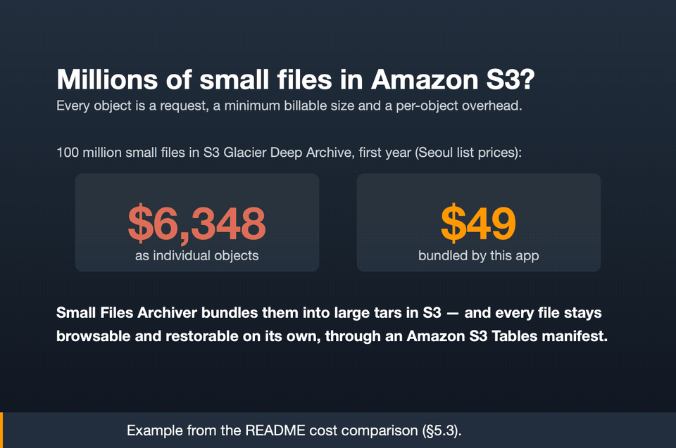</a><br>
  <b>▶ Click the preview for the full 2-minute demo video (MP4, 2.6 MB)</b>
</p>

> These screenshots and the video were taken in a test environment with demo data. Your bucket names and paths will differ.

## Contents

1. [Install and launch](#1-install-and-launch)
2. [First-run setup wizard](#2-first-run-setup-wizard)
3. [The main window](#3-the-main-window)
4. [Archive files](#4-archive-files)
5. [Browse the archive](#5-browse-the-archive)
6. [Restore files](#6-restore-files)
7. [Incremental archiving](#7-incremental-archiving)
8. [Archive from a file-list report](#8-archive-from-a-file-list-report)
9. [Failed files and retry](#9-failed-files-and-retry)
10. [Settings](#10-settings)
11. [Reference](#11-reference): scale, permissions, older tables, notes

---

## 1. Install and launch

Requirements: macOS (the tested platform), Python 3.12 (installed automatically if you have [`uv`](https://docs.astral.sh/uv/)), and an AWS CLI profile (`aws configure` or `aws configure sso`). The app is plain PySide6 and should also run on Linux; *Show failed list* uses Finder and is macOS-only.

```bash
cd v3/gui
./run-gui.sh          # first run creates .venv and installs requirements.txt
```

The app makes outbound AWS API calls only. It opens no network ports.

## 2. First-run setup wizard

On first launch, a setup wizard creates or selects everything the archive needs. You never have to look up an ARN: buckets are chosen by name, and ARNs are derived internally. You can rerun the wizard any time from the toolbar (**Setup wizard**).

### Step 1 — AWS credentials

Choose the AWS CLI profile and Region. The wizard checks the credentials right away. It only reports *works* or *doesn't work*, never your account details.

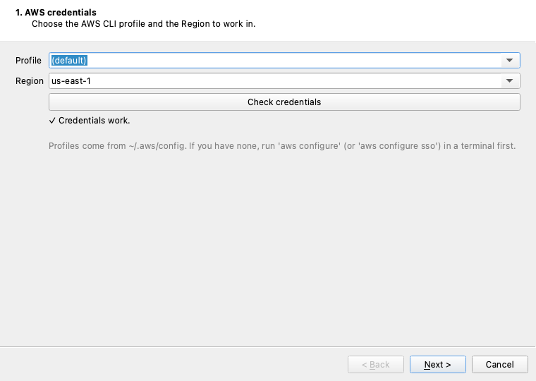

### Step 2 — S3 Tables table bucket

The table bucket holds the manifest. Choose an existing table bucket from the list, or create a new one. The wizard checks the name rules and warns when the name is already taken.

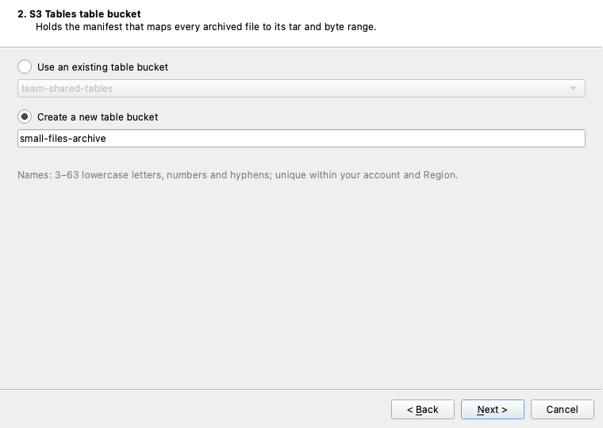

### Step 3 — Bucket for the tar files

Choose an existing general purpose bucket in the Region, or create one. Bucket names are global, so the suggested name has a random suffix. A new bucket is created **private**: all four Block Public Access settings on, ACLs disabled, SSE-S3 encryption.

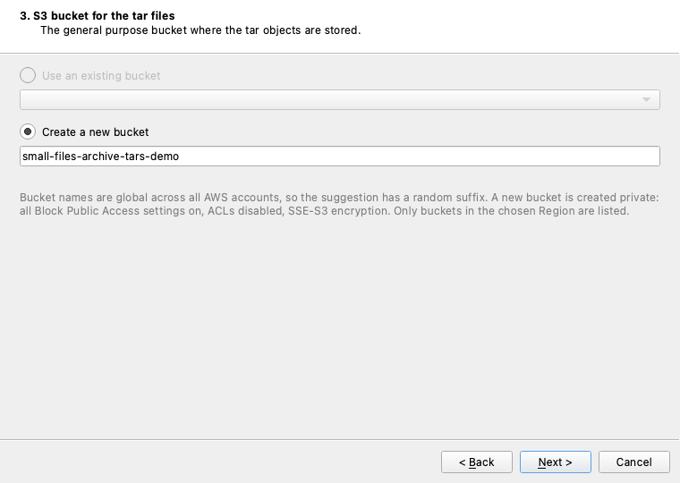

### Step 4 — Manifest tables

Choose a namespace and table name. Three tables are created with the archiver's exact schemas:

| Table | Holds |
|---|---|
| `tar_manifest` | one row per archived file: tar object, byte range, size, MD5, time |
| `tar_manifest_dirs` | folder index with recursive file and byte counts; makes folder browsing fast at billions of files |
| `tar_manifest_runs` | run history; drives incremental archiving |

Existing tables with these names are reused, never overwritten.

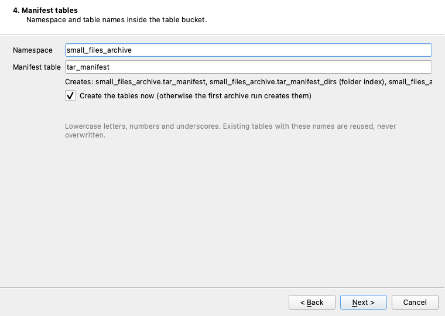

### Step 5 — Review and apply

Nothing is created until you click **Finish**. The wizard then creates each resource and shows the result. Click **Close** when it's done.

| Before Finish | After Finish |
|---|---|
| 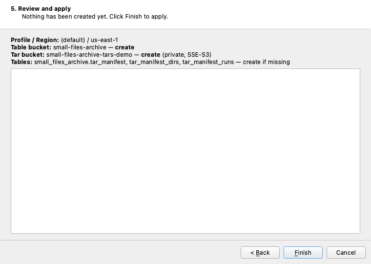 | 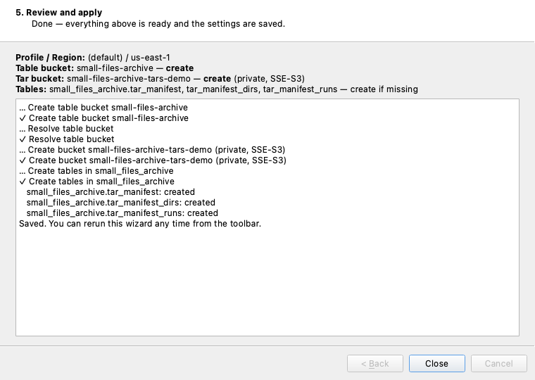 |

## 3. The main window

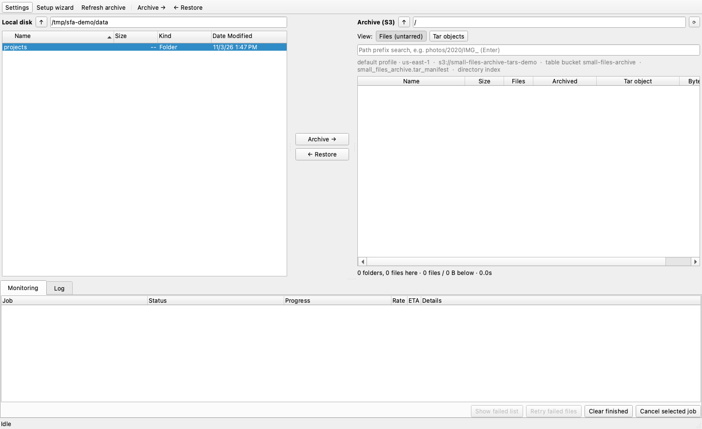

| Area | What it is |
|---|---|
| **Local disk** (left) | Your filesystem. Double-click to open a folder, ↑ to go up, or type a path. Select one or more files or folders to archive. Columns resize like the archive pane's (drag, double-click to fit, right-click to reset). |
| **Archive →** / **← Restore** (middle) | Archive the left selection to S3, or restore the right selection into the current local folder. |
| **Archive (S3)** (right) | The archive. **View: Files (untarred)** shows your original files and folders. **Tar objects** shows the tar files in the bucket. |
| **Archive:** dropdown (right) | The last 10 archives you connected to (tar bucket, table bucket, table, Region). Pick one to switch; the pane reconnects and opens its root. |
| Header line (right) | Profile, Region, tar bucket, table bucket and table. It never shows account IDs or user names. |
| **Monitoring** / **Log** (bottom) | Every archive and restore job with progress, rate and ETA. The Log tab shows the detailed log. |
| Status bar | All running jobs at a glance: how many tars are bundling or uploading, the total rate, and overall progress. |

## 4. Archive files

1. In **Local disk**, select the folders or files to archive. In this example it's `projects`.
2. Click **Archive →**.
3. Check the options and click **Start archiving**.

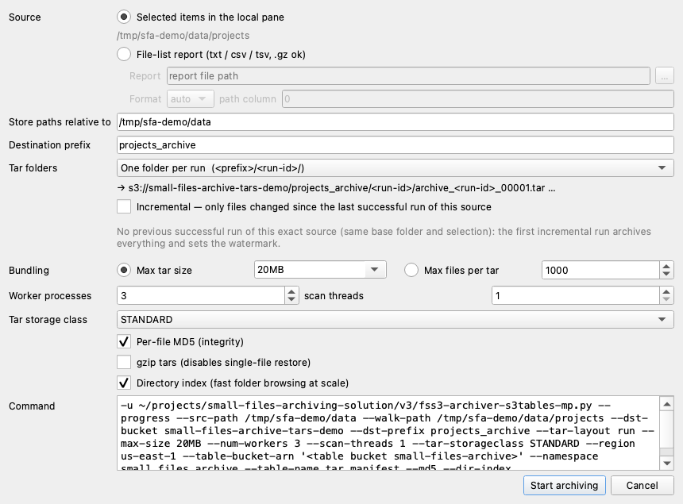

| Option | Meaning |
|---|---|
| **Source** | The items selected in the left pane, or a [file-list report](#8-archive-from-a-file-list-report). |
| **Store paths relative to** | Archived paths are stored relative to this folder. The default keeps the selected folder's own name, so `projects/…` appears in the archive. **Keep it the same across runs.** |
| **Destination prefix** | Where the tars go: `s3://<tar bucket>/<prefix>/…`. |
| **Tar folders** | **One folder per run** (default): `<prefix>/<run-id>/`. Each run, including every incremental run, stays together, so you can check or clean it up as a unit. **One folder per day** (`<prefix>/<YYYYMMDD>/`) and **No subfolder** are also available. Restore works the same with any layout. |
| **Incremental** | Only files changed since the last successful run of this source. See [§7](#7-incremental-archiving). |
| **Bundling** | Close a tar at a size (for example 256 MB) or at a file count. |
| **Upload part size** | 8, 16, 32 (default) or 64 MB. Every multipart part is a billed request; the dialog shows how many requests one tar needs. Larger parts mean fewer requests but more memory. See the main README §5.3 for the cost impact. |
| **Worker processes / scan threads** | Parallel tar builders and uploaders, and parallel file scanners. Raise scan threads for NFS/SMB mounts or large reports. |
| **Tar storage class** | `STANDARD` by default. `GLACIER_IR` is much cheaper and still allows single-file restore. `GLACIER` / `DEEP_ARCHIVE` need an S3 restore before reading. |
| **Per-file MD5** | Stores each file's MD5 so restores are verified. Keep it on. |
| **gzip tars** | Smaller tars, but single-file restore is no longer possible. |
| **Directory index** | Keeps folder browsing fast at any scale. Keep it on. |
| **Command** | The exact archiver command that will run, for reference or for scripting. |

### Watching progress

While a job runs, the **Monitoring** tab shows the overall progress plus one row per tar in flight, each with its own **bundling** or **uploading** bar. The status bar sums up all running jobs.

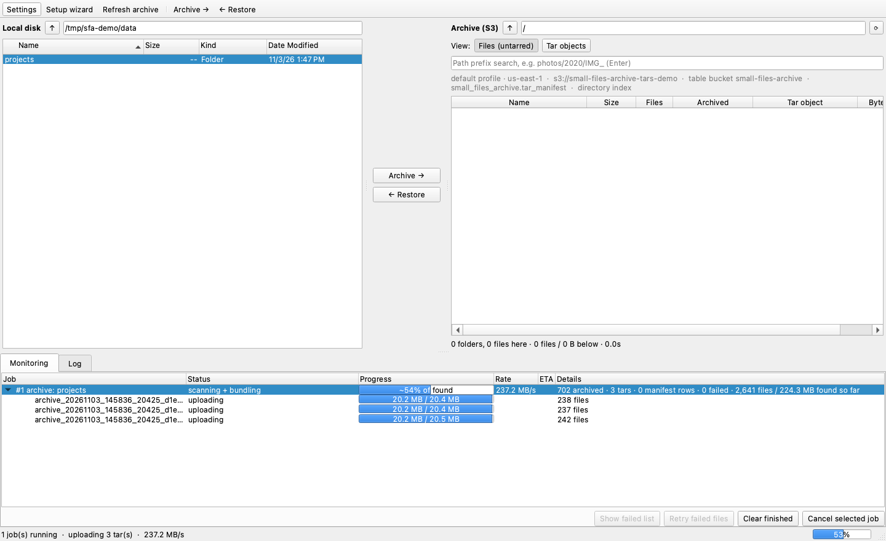

While the source is still being scanned, the total isn't known yet, so the bar shows **"~N% of found"**. It switches to a real percentage with an ETA once scanning finishes. **Cancel selected job** stops a job cleanly: pending manifest rows are saved first.

When the job finishes, the archive pane refreshes and shows the new files.

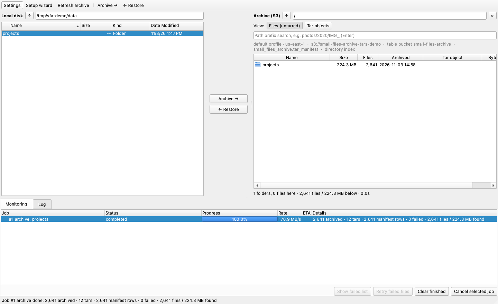

## 5. Browse the archive

### Files view: your original files

**Files (untarred)** shows the archive as the original folder tree, even though the data sits inside tars. Folders show recursive file counts and sizes. Double-click a folder to open it.

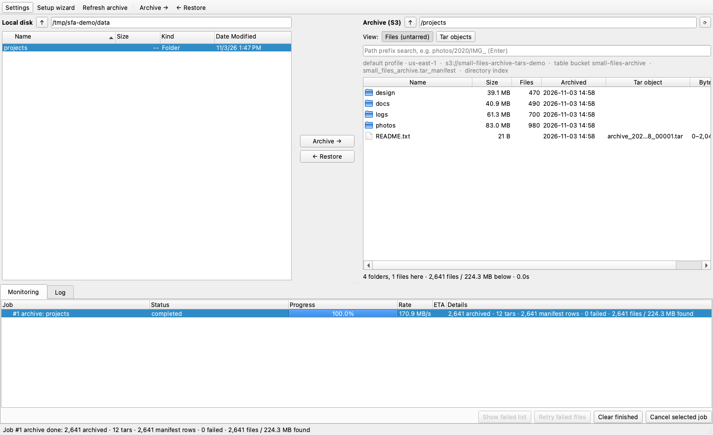

Inside a folder, every file shows its size, archive time, **the tar that holds it** and its **byte range** inside that tar. Hover over a file for the full tar path and MD5. A `[2×]` badge means the file was archived more than once; the newest copy is shown.

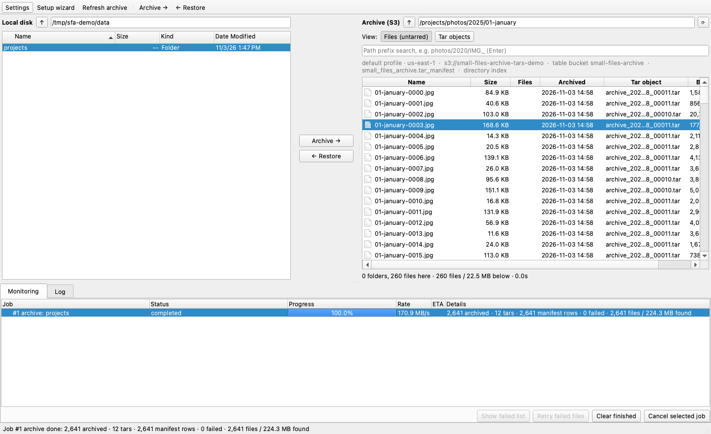

**Columns** can be resized by dragging the header dividers. Double-click a divider to fit that column to its contents, or right-click the header for *Fit columns to contents* and *Reset column widths*. Widths are remembered separately for each view.

**Search** finds files by path prefix across the whole archive, for example `projects/docs/reports/q1/q1-001`. Large folders are paged; use **Show more** to load more.

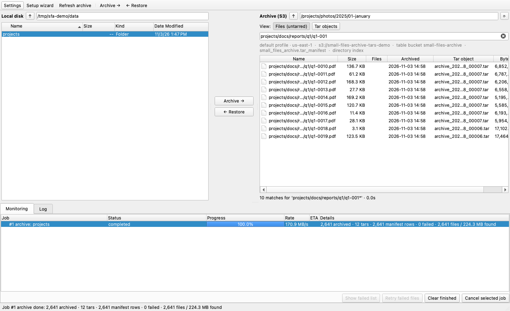

### Tar objects view: the tars in S3

Click **Tar objects** to see the actual tar files in the bucket, with size, storage class and last-modified time. With the default layout there is one folder per run under the destination prefix, named after the run (its date and time come first).

The view keeps your place. Switching from a folder opens the S3 prefix where that folder's tars are and **selects the tars that hold its files**. If the folder's files are spread over several runs (a full run plus incremental runs), it opens the destination prefix and selects **those run folders** instead. Switching back returns to the same folder.

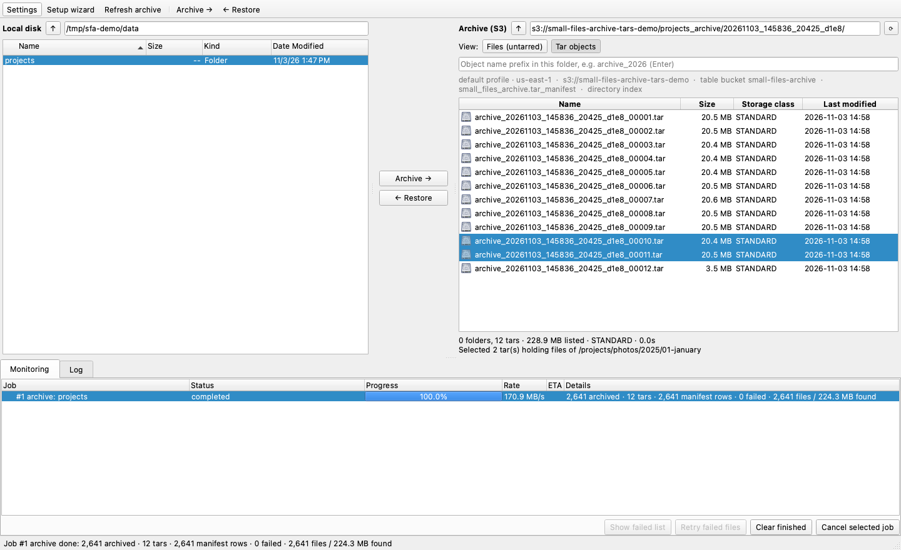

Double-click a tar to list the files inside it, in on-disk order, with byte ranges and MD5. A tar with no manifest rows is flagged as an **orphan**: it was uploaded, but its manifest commit never happened.

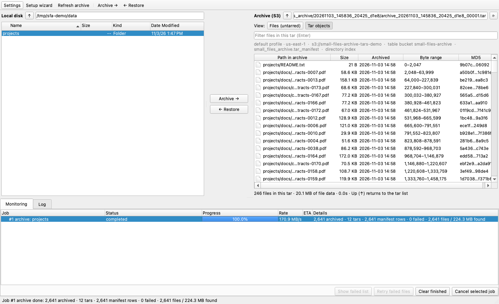

## 6. Restore files

1. In **Local disk**, open the folder to restore into. In this example it's `/tmp/sfa-demo/restore`.
2. In the archive pane, select files or folders. In the Tar objects view you can select whole tars, or files inside an opened tar.
3. Click **← Restore**, check the options and click **Restore**.

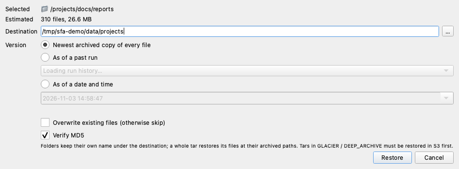

- **What lands where:**
  - A folder keeps its own name under the destination, so `reports/q1/…` comes back as `reports/q1/…`.
  - A file lands directly in the destination.
  - A whole tar restores its files at their archived paths.
- **Version:**
  - **Newest archived copy of every file** (default). For folders this picks the newest copy of each file across all runs.
  - **As of a past run** or **As of a date and time:** see [restore an earlier version](#restore-an-earlier-version).
- **Overwrite existing files:** otherwise existing files are skipped, so a restore can be safely re-run.
- **Verify MD5:** each file is checked against the manifest before it's written.

Restores only fetch the byte ranges they need, and nearby ranges in the same tar are merged into one request. In this example, 310 files came back with **3 GET requests**. Original modification times are kept.

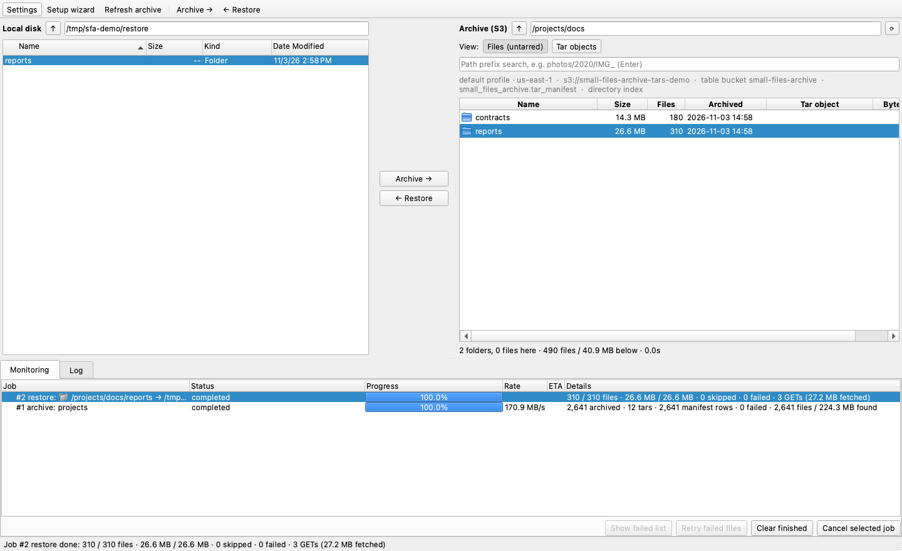

## 7. Incremental archiving

Tick **Incremental** to archive only files that changed since the **last successful run of the same source**, meaning the same base folder and the same selection. The dialog shows which run it compares against.

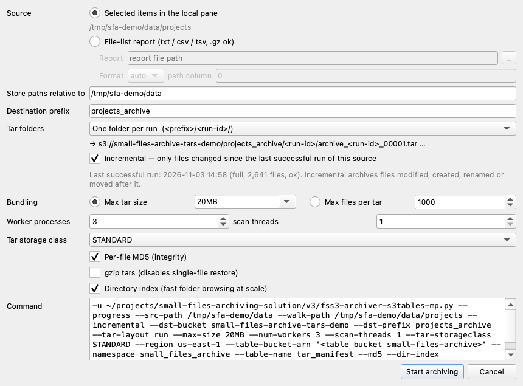

- A file counts as changed when its modification time **or** its change time (ctime) is newer than that run's start. ctime also catches files that were renamed or moved in without being edited.
- The first incremental run of a source archives everything and becomes the baseline.
- Run history is kept in the `tar_manifest_runs` table, so incremental runs continue correctly from another computer.
- Failed or cancelled runs never move the baseline forward.

In this example, 13 changed files were archived and 2,629 unchanged files were skipped:

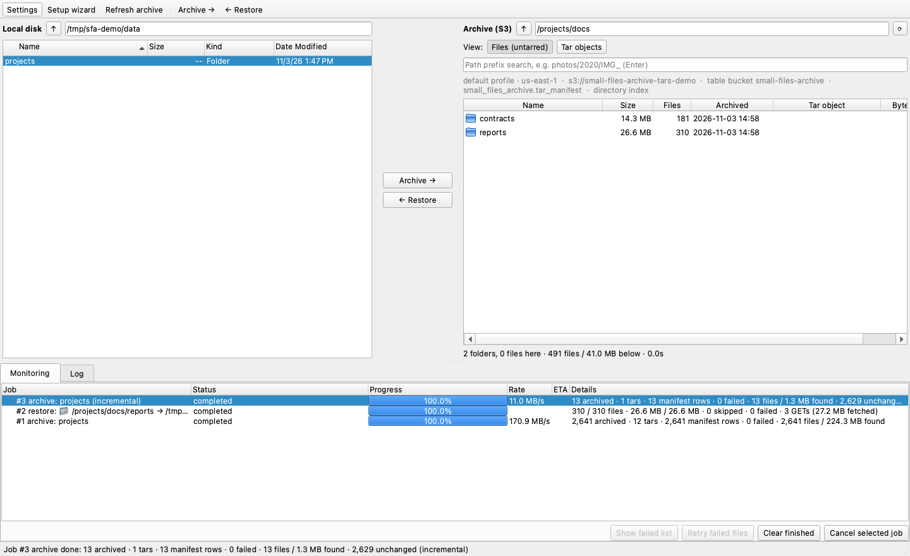

Each incremental run gets its own run folder and holds only the files that changed. The Files view still shows one merged tree with the newest copy of every file, marked `[2×]` when there is more than one.

> ⚠️ **Don't delete an older run folder to save space.** Files that haven't changed since that run exist only in its tars. Deleting run folders is safe only for failed or cancelled runs.

### Restore an earlier version

Because every run is kept, you can bring files back **as they were at a past run**, for example from before an unwanted change was archived. In the Restore dialog, choose **As of a past run** and pick the run, or **As of a date and time**:

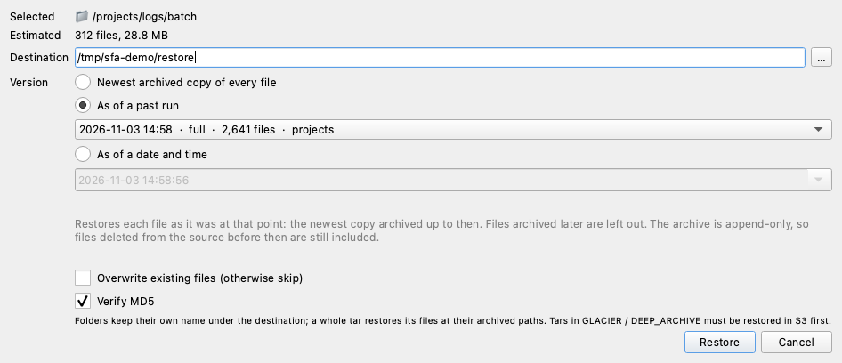

Each file comes back as its newest copy archived up to that point, and files first archived later are left out. The archive is append-only, so files that were deleted from the source before that point are still included. Selecting whole tar objects, or files inside an opened tar, always restores those exact copies, so no version choice is offered.

## 8. Archive from a file-list report

Instead of a folder walk, archive the files listed in a report: an export from a storage system or database, a `find` result, or a change list. Choose **File-list report** in the Archive dialog:

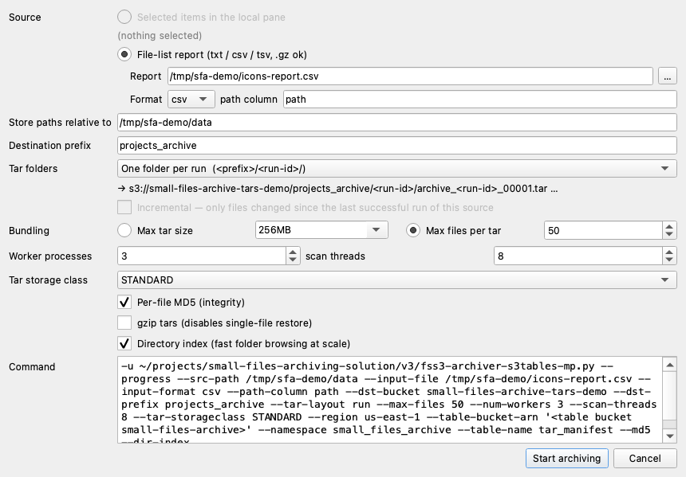

| Field | Meaning |
|---|---|
| **Report** | A `.txt` (one path per line), `.csv` or `.tsv` file, optionally `.gz`. |
| **Format** | `auto` picks by extension. Choose `lines`, `csv` or `tsv` to override. |
| **path column** | The column with the file path: a header name (for example `path`) or a 0-based index. |
| **Store paths relative to** | Relative paths in the report are resolved against this folder, and archived paths are stored relative to it. |

Reports run through the same parallel pipeline as folder walks. Scan threads check files concurrently, then worker processes bundle and upload. Raise **scan threads** for large reports.

## 9. Failed files and retry

Files that can't be archived don't stop the run. A file can fail because it's unreadable, it was deleted, or its tar upload failed. Each failure is recorded, and the job shows **completed — N files failed**.

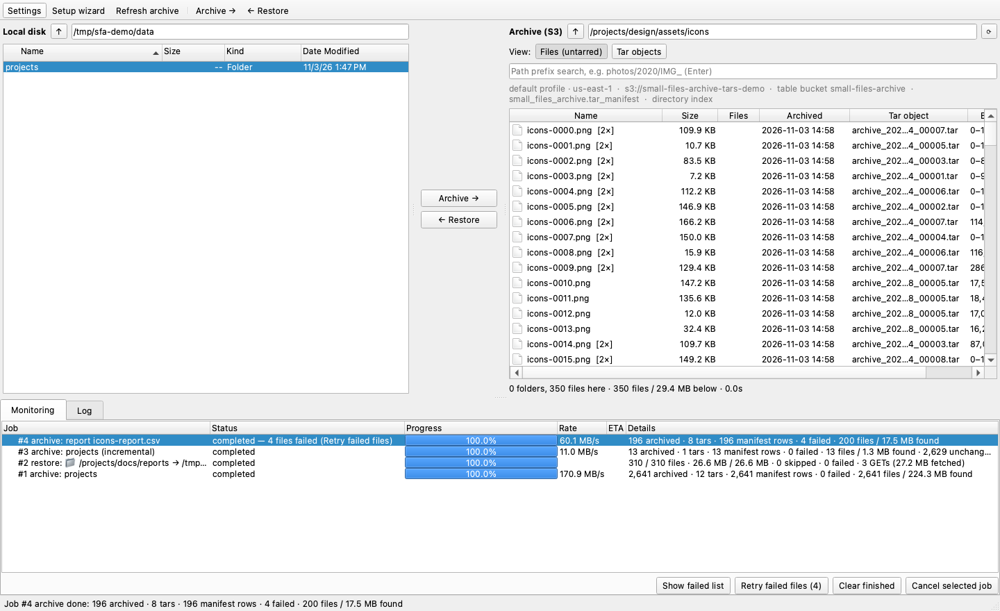

- **Show failed list** opens the list in Finder:
  - `failed_<run-id>.txt` holds one path per line.
  - `failed_<run-id>.tsv` holds each path with its reason.
- **Retry failed files (N)** archives exactly those files again with the same destination and settings, and the same parallelism. Files that fail again go into a new list.

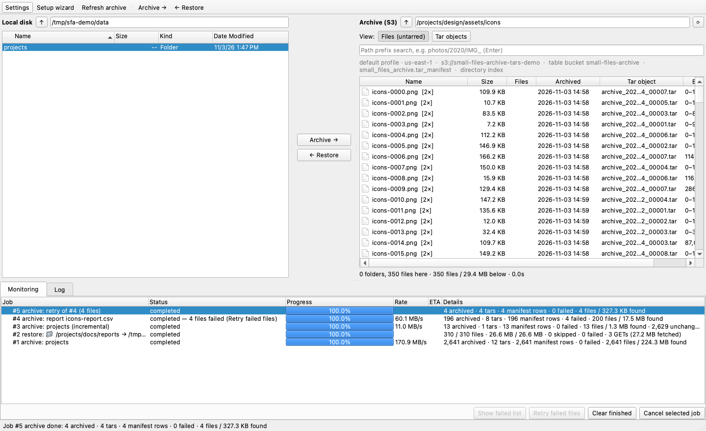

Symlinks and special files are reported as *skipped*, not failed, and are not retried.

The **Log** tab has the full detail for every job, including the failed-list location and the run summary:

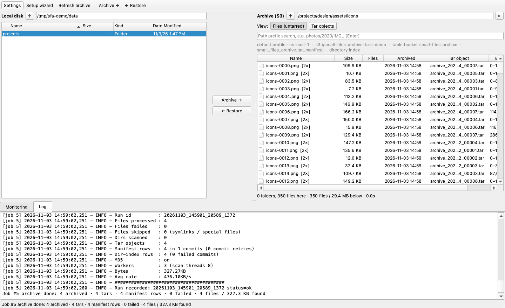

## 10. Settings

**Settings** (⌘,) shows the current connection by name, plus advanced options:

- how many files a folder page shows
- how many parallel requests a restore uses
- the working folder where logs and failed lists are written

**Setup wizard…** reruns the wizard.

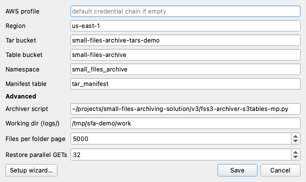

---

## 11. Reference

### Built for GB → PB

| Concern | How the GUI handles it |
|---|---|
| Manifest with billions of rows | It never loads the whole manifest. Each folder listing is two filtered queries: `tar_manifest_dirs` for subfolders with recursive totals, and the manifest `parent_dir == folder` for files. Rows are sorted before each commit, so table statistics narrow each listing to a few data files. |
| A folder with millions of files | Files are paged (5,000 per page, configurable). **Show more** loads 4× as many. **Search** is pushed down to S3 Tables. |
| Restoring a huge folder | Rows stream in batches, so memory stays bounded. Rows are grouped by tar, and ranges with gaps of 1 MiB or less are merged into one GET (up to 64 MiB), with 32 parallel GETs by default. |
| Millions of tars | The Tar objects view lists one S3 prefix level at a time, 1,000 objects per page. |
| Monitoring cost | Progress updates grow with the number of tars in flight, not the number of files. The log view keeps the last 5,000 lines. |

### IAM permissions

| Use | Permissions |
|---|---|
| Archive | S3 Tables read/write on the table bucket (see the main README §2) and `s3:PutObject` on the tar bucket |
| Browse and restore | S3 Tables read, `s3:ListBucket` and `s3:GetObject` on the tar bucket |
| Setup wizard | `s3tables:ListTableBuckets`, `CreateTableBucket`, `CreateNamespace`, `CreateTable`, `s3:ListAllMyBuckets`, `CreateBucket`, `PutBucketPublicAccessBlock`, `PutEncryptionConfiguration`, `PutBucketOwnershipControls` |
| All | `sts:GetCallerIdentity` (credential check; the result is never displayed) |

### Privacy on screen

Everything the app displays passes through a masking filter: the header, log, status bar, error messages and command preview. It replaces 12-digit AWS account IDs and IAM/STS user, role and session names with `****`. The table bucket is always shown by name, never by ARN.

### Older tables (created before the directory index)

The archiver writes the `parent_dir` column and the `tar_manifest_dirs` table (`--dir-index`, on by default). On a table created by an older v3 archiver, the first new run adds `parent_dir` through additive Iceberg schema evolution and creates the folder index. No existing data is rewritten.

- **Table with no index at all:** the GUI falls back to a bounded prefix scan (200k rows) and labels the view *legacy*.
- **Mixed table** (older rows have `parent_dir = NULL`): the folder view doesn't show the older rows. Search still finds them, and the header shows a warning.

#### Backfill (one-time, Athena, run it on a test copy first)

These statements haven't been run against real S3 Tables yet. Check the counts on a copy first.

```sql
-- 1) directory index rows for the legacy files (run BEFORE step 2)
INSERT INTO "s3tablescatalog/<table-bucket>"."small_files_archive"."tar_manifest_dirs"
SELECT CASE WHEN n = 1 THEN '' ELSE array_join(slice(p, 1, n - 1), '/') END AS parent_dir,
       array_join(slice(p, 1, n), '/')                                      AS dir_path,
       count(*) AS files, sum(filesize) AS bytes,
       current_timestamp AS archive_ts, 'backfill' AS run_id
FROM (SELECT split(regexp_replace(source_key, '/[^/]*$', ''), '/') AS p, filesize
      FROM "s3tablescatalog/<table-bucket>"."small_files_archive"."tar_manifest"
      WHERE parent_dir IS NULL AND strpos(source_key, '/') > 0)
CROSS JOIN UNNEST(sequence(1, cardinality(p))) AS t(n)
GROUP BY 1, 2;

-- 2) parent_dir on the legacy manifest rows
UPDATE "s3tablescatalog/<table-bucket>"."small_files_archive"."tar_manifest"
SET parent_dir = CASE WHEN strpos(source_key, '/') = 0 THEN ''
                      ELSE regexp_replace(source_key, '/[^/]*$', '') END
WHERE parent_dir IS NULL;
```

### Notes

- **Re-archived paths:** the Files view shows the newest copy with a `[N×]` badge. Folder totals count every run, so they include re-archived copies.
- **Cancel:** pending manifest rows are committed before the archiver exits. Tars that were mid-upload can be left as orphans; the Tar objects view flags them. Reconcile as described in the main README §6.
- **Keep the base folder stable:** archived paths are relative to "Store paths relative to". Using different bases for overlapping trees makes their paths collide (main README §6).
- **Compressed tars:** they show `compressed` in *Byte range* and can't be restored file by file.
- **Glacier and Deep Archive tars:** they need an S3 restore before the GUI can read them. Glacier Instant Retrieval works directly.
- **Command line:** everything the GUI does is also available through `../fss3-archiver-s3tables-mp.py` and `../fss3-restore.py`; see the main README.
